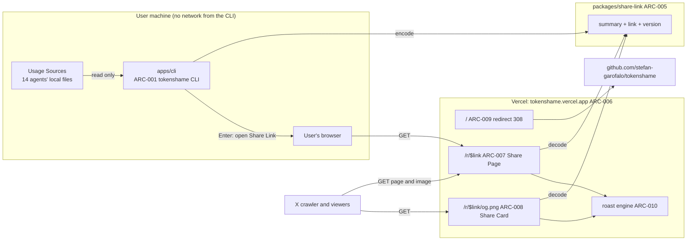
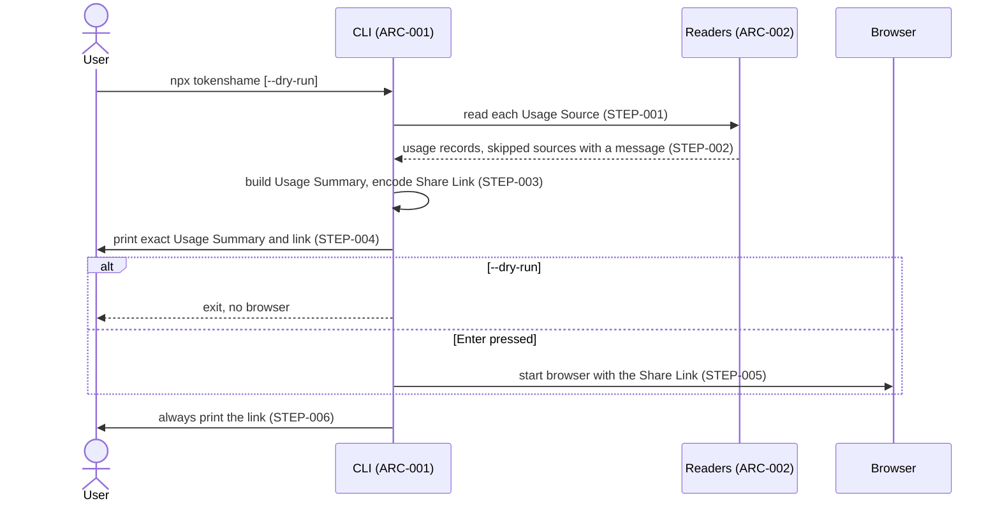
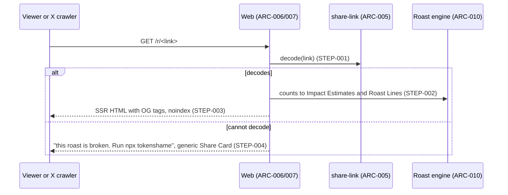

# Architecture: Usage Roast Share

## Context and Scope

- Capability identity: `apps/wiki/content/docs/project/specs/tokenshame/usage-roast-share/`. Boundary: a CLI that reads local coding-agent usage logs, a `packages/share-link` format, and a Vercel-hosted Share Page and Share Card for X. Source: log#Q1, log#Q2, log#Q32.
- Actors and outcome: a developer who uses coding agents runs `npx tokenshame`. They get a funny, shareable Share Page and Share Card. A viewer on X sees the Share Card and can open the Share Page. The developer must trust that no prompt text, login, or key leaves their machine (log#Q1, log#Q5).
- In scope: the CLI, `packages/share-link`, the `apps/web` routes `/`, `/r/$link`, `/r/$link/og.png`, the roast engine, tests, distribution names (log#Q13, log#Q23, log#Q46).
- Non-goals: no database, no stored shares, no leaderboard (log#Q6); no local report page (log#Q7); no landing page or methodology page (log#Q10); no Deno or jq mode (log#Q14); no Cursor, Kiro, or Devin source (log#Q16); no ozone metric (log#Q21); no API-key or admin-key input (log#Q1).
- Spec: sibling `SPEC.md` in the same folder. No link here, because a link to a file that is not in this retained commit would not resolve.

## Canonical Terms

Terms, relationships, and axioms come from the status glossary (S3) and the published page `apps/wiki/content/docs/project/domains/tokenshame-glossary.mdx` (S5). The status glossary lists axioms AX-1 to AX-4. S5 also lists AX-5, which comes from log#Q48 (the status glossary has no entry for it).

- **Usage Source**: one local folder or file where a coding agent writes token counts.
- **Usage Summary**: the small set of numbers the CLI computes from Usage Sources. It holds no prompt text.
- **Share Link**: a public URL on the share domain that carries the Usage Summary inside itself.
- **Share Page**: the HTML page a Share Link opens.
- **Share Card**: the 1200×630 image for a Share Link. X shows it as the link card. The user can also paste it into a post.
- **Roast Line**: one generated sentence that turns a Usage Summary number into a joke comparison.
- **Impact Estimate**: a real-world quantity from token counts, with a stated assumption and source, shown as a dreadful comparison.
- **Tokens Processed**: the public headline number. It is the raw total of all tokens. Public copy never says "cache".
- **Consent Prompt**: the CLI step that shows the exact Usage Summary and asks before the browser opens a Share Link.

Axioms (status glossary, Axioms):

- AX-1 No prompt or message text leaves the user's machine.
- AX-2 The CLI never asks for a login, API key, or admin key.
- AX-3 The CLI makes no network request. Only the user's browser contacts the share domain.
- AX-4 The share domain stores nothing. A Share Link alone renders its Share Page and Share Card.
- AX-5 Every `apps/web` page is built with the `/design-taste-frontend` skill (log#Q48).

## Sources

Anchor rule: `log#Q<N>` is the heading `### Q<N>: <name>` in the log. `log#Q15a1` and `log#Q15a2` are the headings `### Q15 amendment: gap note placement` and `### Q15 amendment 2: gap note removed`.

| Source | Role | Exact location and anchor | Immutable revision or content hash |
| --- | --- | --- | --- |
| S1 | Grill status and closure | `apps/wiki/content/docs/project/grilling/tokenshame-grill-status.md`; Current Round (`Closure: closed R9`), Branch Dashboard | sha256 `1ca11d93a6af0b63…` (file untracked at compile time; the retention commit gives the immutable identity) |
| S2 | Durable grill log | `apps/wiki/content/docs/project/grilling/tokenshame-grill-log.md`; Q1–Q49, `## Closure` | sha256 `ee011af4dd7781cf…` (same note) |
| S3 | Current glossary | S1, `## Glossary` | same as S1 |
| S4 | Existing code (observed current behavior) | `apps/cli/src/index.ts:reportServer`, `apps/cli/tsdown.config.ts` (`copy` of `../web/dist/client`), `apps/cli/package.json` (`web: workspace:*`), `apps/web/vite.config.ts` (`tanstackStart({ spa: { enabled: true } })`), `apps/web/src/routes/__root.tsx` (`head()` with title only) | sha256 `b778836a…`, `3c388ee0…`, `ac5b64c2…`, `2b27fe58…`, `ff6453b4…` |
| S5 | Published glossary | `apps/wiki/content/docs/project/domains/tokenshame-glossary.mdx` | sha256 `9298cfb1a96b88b9…` |
| S6 | Grounding reports (probe evidence, not durable) | Subagent reports of R0–R6 in S1 Technical Grounding; probe files `/tmp/ts-ground-web`, `/tmp/ts-ground-cli` | not retained; see Validation limits |
| S7 | Prior research (not a decision source) | `/var/folders/y8/fw7tz9gn7yx645tf162zwlnr0000gp/T/handoff-tokenshame-2026-11-11.md`; T3 thread `2fff6874-5270-4b0a-afbd-721916400609` | not retained |

## Source Disposition

| Question / entry | Disposition | Accepted detail, replacement, or unresolved point | Evidence | Parked owner / resume trigger |
| --- | --- | --- | --- | --- |
| log#Q1–log#Q14 | accepted | See Accepted Detail Coverage. | S2 | — |
| log#Q15 | accepted, partly superseded | The merge rule stays (cache up to `lastComputedDate`, logs after). The clause "the Share Page and Share Card say so" is superseded by log#Q15a1, then fully by log#Q15a2. | S2 | — |
| log#Q15a1 | superseded | Card note removed. Replaced by log#Q15a2. | S2 | — |
| log#Q15a2 | accepted | No public missing-days note. | S2 | — |
| log#Q16–log#Q29 | accepted | See coverage. | S2 | — |
| log#Q30 | superseded | The user's mental model conflicted with log#Q5 and log#Q6. Replaced by log#Q32 (option A). | S2 | — |
| log#Q31–log#Q49 | accepted | See coverage. | S2 | — |
| log#Q29 (Muse default home) | accepted with an unknown | If research finds no default folder, Muse is dropped from v1. | S2 | Owner: implementation of the Muse reader. Resume trigger: first Muse reader task. |

## Whole System

The system has three deployables and one shared package. The CLI runs on the user's machine. The web app runs on Vercel. They share only the Share Link format.



Source anchors: log#Q1, log#Q2, log#Q5, log#Q17, log#Q32, log#Q33, log#Q35, log#Q36, log#Q46.
Conclusion: the CLI never talks to the network, and the server holds no state. The Share Link is the only thing that crosses the boundary. It crosses only when the user's browser opens it (AX-3, AX-4).

| Block selector / component / level | Owner | State and authority | Interface / dependency | Supported constraint and source |
| --- | --- | --- | --- | --- |
| <a id="arc-001"></a>ARC-001 CLI (`apps/cli`, npm `tokenshame`) | CLI package | Reads only. Holds no state between runs. | Node ≥ 22.13; `effect` 4.1.2 and `@effect/platform-node` bundled by tsdown, zero runtime dependencies | AX-2, AX-3; log#Q1, log#Q5, log#Q37 |
| <a id="arc-002"></a>ARC-002 Agent readers (`apps/cli/src/agents/<agent>.ts`, `agents/sqlite.ts`) | CLI package | Each reader reads one Usage Source and returns usage records. | Plain functions on `FileSystem`, `Path`; SQLite through `node:sqlite` read-only | AX-1; log#Q3, log#Q16, log#Q37, log#Q43 |
| <a id="arc-003"></a>ARC-003 Summary builder (`apps/cli/src/summary.ts`) | CLI package | Pure functions: usage records to Usage Summary. | Uses the Summary schema from ARC-005 | log#Q4, log#Q15, log#Q24, log#Q34 |
| <a id="arc-004"></a>ARC-004 Consent Prompt and launcher (`render.ts`, `prompt.ts`) | CLI package | Prints the exact Usage Summary. Waits for Enter. | `effect/Terminal` for one keypress; `ChildProcess` from `effect/process` to start `open`, `xdg-open`, or `start`; always prints the link | log#Q5, log#Q37, log#Q43 |
| <a id="arc-005"></a>ARC-005 share-link package (`packages/share-link/src/{summary,link,version}.ts`) | share-link package | Authority for the Share Link format and all link versions. | Effect Schema; JSON with short keys, then base64url, with `v: 1`; exports `"./*": "./src/*.ts"`; the CLI bundles it, `apps/web` imports it | AX-4; log#Q33, log#Q34, log#Q38, log#Q42 |
| <a id="arc-006"></a>ARC-006 Web app (`apps/web`) | web package | Stateless. Server-rendered. | TanStack Start 1.169.5 without `spa`; `nitro/vite` plugin; Vercel Node functions; `engines.node` `24.x` | log#Q36, log#Q40, log#Q47 |
| <a id="arc-007"></a>ARC-007 Share Page route (`routes/r/$link.tsx`, page UI in `composition/routing/pages/share/`) | web package | Decodes the link in the loader. Renders HTML. | `head()` sets title, description, `og:*`, `twitter:card=summary_large_image`, `twitter:image`, `robots=noindex`; `headers()` sets caching | log#Q2, log#Q9, log#Q18, log#Q27, log#Q40, log#Q41 |
| <a id="arc-008"></a>ARC-008 Share Card route (`routes/r/$link/og[.]png.tsx`) | web package | Draws a PNG from the decoded link. | `server.handlers.GET`; `takumi-js` 2.20.0 `ImageResponse`, WASM backend; WOFF2 font via `?inline`; `Cache-Control: public, immutable` | log#Q8, log#Q25, log#Q36, log#Q39 |
| <a id="arc-009"></a>ARC-009 Root redirect (`routes/index.tsx`) | web package | None. | `beforeLoad` throws `redirect({ href, statusCode: 308 })` to `https://github.com/stefan-garofalo/tokenshame` | log#Q10, log#Q17, log#Q46 |
| <a id="arc-010"></a>ARC-010 Roast engine (`apps/web/src/roast/{factors,prices,impacts,lines,pick}.ts`) | web package | Server owns price table and impact factors, each with value, unit, source, date. | Counts in, Impact Estimates and Roast Lines out | log#Q11, log#Q20, log#Q21, log#Q24, log#Q28, log#Q35, log#Q45 |
| <a id="arc-011"></a>ARC-011 Design process for pages | web package process | Every page is built with `/design-taste-frontend`. | Skill steps: draw, idea, copy deck, build, `lint.mjs` and `inspect.mjs` gate, critique. `--allow` only for the picture-floor and motion-count rules. The Share Card follows the same direction, colors, and type. | AX-5; log#Q48, log#Q49 |
| <a id="arc-012"></a>ARC-012 Tests and tooling | repo | Fixtures hold fake numbers and no real prompts. | `vitest` and `@effect/vitest`; turbo `test` task; colocated `*.test.ts` | log#Q44 |
| <a id="arc-013"></a>ARC-013 Distribution | repo | npm package `tokenshame`; Vercel project for `apps/web`; public GitHub repo. | Domain `tokenshame.vercel.app`; no custom domain | log#Q13, log#Q23, log#Q46 |

Observed current behavior (S4) that this design changes: the CLI serves the web SPA on `127.0.0.1` (`reportServer`, `tsdown.config.ts` copy, `web` devDependency). The web app runs in SPA mode, so its HTML carries only the root route's tags. The design removes the local server and the copy, and removes SPA mode. This is accepted design (log#Q7, log#Q36). It is not current behavior.

## Critical Flows and Boundaries

<a id="flow-001"></a>
### FLOW-001 Run the CLI and open the Share Link



| Selector | Step | Accepted detail | Source |
| --- | --- | --- | --- |
| <a id="flow-001-step-001"></a>FLOW-001-STEP-001 | Read sources | Read all 14 agents: Claude Code, Codex, opencode, Copilot CLI, Pi, Gemini CLI, Grok, Qwen, Amp, Droid, Kimi, Goose, Antigravity, Muse. Never the T3 Code scan cache. Muse only if its default folder exists or `MUSE_HOME` is set. The CLI never starts Muse. | log#Q16, log#Q29 |
| <a id="flow-001-step-002"></a>FLOW-001-STEP-002 | Handle failures | A source that fails to open (for example a `-wal` file without a `-shm` file in a read-only folder) is skipped with a message. If no logs are found, the CLI lists the folders it checked and exits with no link. | log#Q27, log#Q43 |
| <a id="flow-001-step-003"></a>FLOW-001-STEP-003 | Summarize and encode | All time. Claude Code: `stats-cache.json` totals up to `lastComputedDate`, then jsonl logs for later days. opencode: sum `session` or `message`, not both. Raw counts per model family (input, output, cacheRead, cacheWrite); top 8 models by tokens, the rest as "other"; session count, busiest hour, first-day date, `v`. No project names, paths, or prompt text. | log#Q4, log#Q15a2, log#Q34, log#Q42 |
| <a id="flow-001-step-004"></a>FLOW-001-STEP-004 | Consent | Print the exact Usage Summary. The CLI itself sends nothing. | log#Q5 |
| <a id="flow-001-step-005"></a>FLOW-001-STEP-005 | Open | Press Enter to open the link with `open`, `xdg-open`, or `start`. | log#Q5, log#Q37 |
| <a id="flow-001-step-006"></a>FLOW-001-STEP-006 | Print link | Always print the link, also on hosts with no browser. | log#Q37 |

Question anchors: log#Q3–log#Q5, log#Q15, log#Q16, log#Q27, log#Q29, log#Q34, log#Q37, log#Q42, log#Q43.
Conclusion: every network step is the browser's, not the CLI's. A broken source cannot stop the run, and an empty run produces no link. So AX-1 to AX-3 hold even when sources fail.

<a id="flow-002"></a>
### FLOW-002 Open the Share Page



| Selector | Step | Accepted detail | Source |
| --- | --- | --- | --- |
| <a id="flow-002-step-001"></a>FLOW-002-STEP-001 | Decode | The server decodes every link version it ever shipped. | log#Q38, log#Q42 |
| <a id="flow-002-step-002"></a>FLOW-002-STEP-002 | Compute | Weighted tokens drive Impact Estimates (a cache read counts about 0.1 token). Cost uses per-model prices, cache reads at their own price. Lines are chosen deterministically; the card shows the top 3 by dread, the page shows all; ties break by a hash of the link. | log#Q24, log#Q28, log#Q35, log#Q45 |
| <a id="flow-002-step-003"></a>FLOW-002-STEP-003 | Render | The page shows Roast Lines and key numbers, an "ⓘ how we calculated" note with a link to the README section "How we calculate", a "Post on X" button, a "Copy image" button, and a "run it yourself: `npx tokenshame`" box. It shows no agent list, date range, or missing-days note. | log#Q9, log#Q19, log#Q22, log#Q31 |
| <a id="flow-002-step-004"></a>FLOW-002-STEP-004 | Broken link | Message "this roast is broken. Run `npx tokenshame`" and a generic Share Card. | log#Q27, log#Q38 |

Question anchors: log#Q9, log#Q18, log#Q19, log#Q24, log#Q27, log#Q28, log#Q31, log#Q35, log#Q38, log#Q41, log#Q45.
Conclusion: the same decoded link feeds the page and the card, and line choice has no randomness. So the page and the card always match, also after X caches the card.

<a id="flow-003"></a>
### FLOW-003 Fetch the Share Card

| Selector | Step | Accepted detail | Source |
| --- | --- | --- | --- |
| <a id="flow-003-step-001"></a>FLOW-003-STEP-001 | Request | X crawler or a browser requests `/r/<link>/og.png`. The `og:image` URL is absolute. The site address comes from `VERCEL_PROJECT_PRODUCTION_URL` (declared in `apps/web/.env.schema`); local dev uses `http://localhost:3001`. | log#Q41 |
| <a id="flow-003-step-002"></a>FLOW-003-STEP-002 | Draw | Decode, compute, draw 1200×630 with `takumi-js`: headline "N tokens processed", the three most dreadful Roast Lines, the domain, and `npx tokenshame`. No agent list, date range, or gap note. | log#Q25, log#Q39 |
| <a id="flow-003-step-003"></a>FLOW-003-STEP-003 | Cache | Respond with `Cache-Control: public, immutable`. The CDN keeps each card. A link's content never changes. | log#Q36, log#Q32 |

Question anchors: log#Q25, log#Q32, log#Q36, log#Q39, log#Q41.
Conclusion: the card is made once per link, at first request, so it is "render time", not build time. Later views are served from the CDN.

<a id="flow-004"></a>
### FLOW-004 Share to X

| Selector | Step | Accepted detail | Source |
| --- | --- | --- | --- |
| <a id="flow-004-step-001"></a>FLOW-004-STEP-001 | Link card | The user posts the Share Link. X shows the Share Card from the page tags. | log#Q8 |
| <a id="flow-004-step-002"></a>FLOW-004-STEP-002 | Image in post | The user presses "Copy image" on the Share Page and pastes the PNG with Cmd+V. The CLI is not involved. | log#Q8, log#Q22 |
| <a id="flow-004-step-003"></a>FLOW-004-STEP-003 | Post on X button | The page has a "Post on X" button. The exact X composer URL is not recorded in the grill. | log#Q9 |

Question anchors: log#Q8, log#Q9, log#Q22.
Conclusion: both ways of sharing live on the page, so the CLI stays free of network calls (AX-3).

## Modules and Interfaces

Accepted L3 decisions (log#Q33, log#Q37, log#Q39, log#Q40, log#Q42, log#Q43, log#Q45). Existing files are marked; all others are accepted proposals.

```text
packages/share-link/                      ARC-005 (new)
  src/summary.ts    Usage Summary schema (per-model counts, top 8 + other, sessions, busiest hour, first day)
  src/link.ts       encode, decode (all versions), share URL
  src/version.ts
  src/link.test.ts
apps/cli/src/                             ARC-001..004
  index.ts          (existing) command, flags, SQLite warning filter; reportServer removed
  agents/<agent>.ts one plain reader per agent; one registry list; no Effect services, no barrels
  agents/sqlite.ts  read-only node:sqlite helper (opencode, Copilot CLI, Goose, Antigravity)
  summary.ts  render.ts  prompt.ts
apps/web/src/                             ARC-006..010
  routes/index.tsx            (existing) becomes the 308 redirect
  routes/r/$link.tsx          Share Page
  routes/r/$link/og[.]png.tsx Share Card
  roast/{factors,prices,impacts,lines,pick}.ts
  composition/routing/pages/share/   page UI (existing pattern: pages/home/)
```

- Dependency direction: `apps/cli` and `apps/web` depend on `packages/share-link`. Neither depends on the other. The `web: workspace:*` devDependency and the tsdown `copy` of `../web/dist/client` are removed (log#Q7, log#Q37).
- Imports use module paths (`effect/Schema`), not the `effect` barrel (S4 lint rule `effect-js/no-import-from-barrel-package`, observed).
- Antigravity: a small hand-written protobuf decoder for the needed fields (usage fields: 1 model id, 2 uncached input, 3 output, 4 cache write, 5 cache read, 9 reasoning; observed in the grounding report, S6). Model ids go in the link raw. The server maps ids to names and prices (log#Q42).
- SQLite: `new DatabaseSync(path, { readOnly: true })`. `engines.node` is `>=22.13`. A filter hides only the SQLite `ExperimentalWarning` (log#Q37).
- `apps/web/vite.config.ts`: remove `spa`; plugin order `tanstackStart()`, `nitro()`, `viteReact()`, plus the existing varlock and tailwind plugins (log#Q40).

## Accepted Detail Coverage

| Question + exact entry/evidence anchor | Exact accepted choice and supplied detail | Provided rationale / alternatives | Architecture selector + applicable visual | System constraint served |
| --- | --- | --- | --- | --- |
| log#Q1 | Local CLI reads agents' logs; no login, no key | Rejected: sign-in with AI provider | ARC-001; system map | AX-2 |
| log#Q2 | Public Share Page on the user's Vercel app, with SEO meta and OG image for X | Rejected: page served only on the user's machine (X cannot fetch it) | ARC-006, ARC-007; system map | X card needs a public URL |
| log#Q3 | All three of Claude Code, Codex, opencode, plus other agents with local token data | Rejected: Claude Code and Codex only | ARC-002; FLOW-001-STEP-001 | Coverage |
| log#Q4 | All time | Rejected: only what is found, with date range shown | ARC-003; FLOW-001-STEP-003 | Honest totals |
| log#Q5 | Print exact Usage Summary; Enter opens link; CLI sends nothing; `--dry-run` | not recorded | ARC-004; FLOW-001-STEP-004/005 | AX-3 |
| log#Q6 | No DB, no stored shares, no leaderboard; also a cost reason | not recorded | ARC-006; system map | AX-4 |
| log#Q7 | Drop the local report page. Remove `reportServer` and the web copy | not recorded | ARC-001, ARC-013; Modules | One page to keep |
| log#Q8 | Link card and a pasteable image | not recorded | FLOW-004 | Reach |
| log#Q9 | Page shows Roast Lines, key numbers, "ⓘ how we calculated", "Post on X", `npx tokenshame` box | not recorded | ARC-007; FLOW-002-STEP-003 | Page content |
| log#Q10 | No landing page, no methodology page; README presents the project | Rejected: indexable landing and methodology pages ("absolutely not") | ARC-009 | Scope |
| log#Q11 | Self-roast tone; Olympic pools, years of showers, bottles of water; API-price cost as vices; CO2, trees, GPU heat | not recorded | ARC-010 | Content |
| log#Q12 | Agent writes all lines, with humanizer and human-writing skills | not recorded | ARC-010 | Content |
| log#Q13 | Product and npm name `tokenshame` | not recorded | ARC-013 | Naming |
| log#Q14 | No Deno mode, no jq mode | Rejected: both | Context and Scope | Scope |
| log#Q15, log#Q15a1, log#Q15a2 | Cache up to `lastComputedDate`, logs after; no public gap note | Rejected: CLI keeps own history (after v1) | ARC-003; FLOW-001-STEP-003 | Honest totals without extra state |
| log#Q16 | All agents with local data, now; Cursor, Kiro, Devin excluded; T3 scan cache never counted | Rejected: tiered launch | ARC-002; FLOW-001-STEP-001 | Coverage; no double count |
| log#Q17 | Root redirects to GitHub | not recorded | ARC-009 | Scope |
| log#Q18 | `noindex` on Share Pages; full OG and Twitter tags stay | not recorded | ARC-007 | Privacy of strangers' numbers |
| log#Q19 | "how we calculated" note links to README "How we calculate" | not recorded | ARC-007; FLOW-002-STEP-003 | Defensible numbers |
| log#Q20 | API-price cost as vices: cigarette packs and similar | Rejected: warning-label card style | ARC-010 | Content |
| log#Q21 | CO2 as flights, tons, coal-plant hours (India or ex-ILVA Taranto); trees for a year; GPU heat as homes heated; villages supplied (WHO ~20 L/person/day); no ozone | Rejected: kettles, space-heater hours, ozone line, dropping villages | ARC-010 | Content; fact-check basis |
| log#Q22 | "Copy image" button on the Share Page | Rejected: CLI downloads the card | FLOW-004-STEP-002 | AX-3 |
| log#Q23 | `tokenshame.vercel.app`; new Vercel project for `apps/web` | Rejected: `tokenshame.com`, `tokenshame.stefangarofalo.dev` | ARC-013 | Distribution |
| log#Q24 | Headline raw total labelled "tokens processed", no "cache"; impacts use weighted tokens (cache read about 0.1); cost uses per-model prices | Rejected: "incl. cache" label; raw total for all impacts | ARC-010; FLOW-002-STEP-002 | Defensible numbers |
| log#Q25 | Card: headline, three most dreadful lines, domain, command. No agents, dates, gap note | Rejected: agents, dates, gap on card | ARC-008; FLOW-003-STEP-002 | Card clarity |
| log#Q26 | macOS, Linux, Windows; paths from the home folder; tested on macOS only | not recorded | ARC-001, ARC-002 | Reach |
| log#Q27 | No logs: list folders, exit, no link. Broken link: message and generic card | not recorded | FLOW-001-STEP-002; FLOW-002-STEP-004 | Safe failure |
| log#Q28 | Same link, same lines (deterministic) | Rejected: random per view | ARC-010; FLOW-002-STEP-002 | Page and card match |
| log#Q29 | Muse via default folder or `MUSE_HOME`; if none, drop Muse; never start Muse | not recorded | ARC-002; FLOW-001-STEP-001 | AX-1 |
| log#Q31 | No gap note or agent list on page or card | Rejected: honesty footer | ARC-007; FLOW-002-STEP-003 | Page clarity |
| log#Q32 | Vercel renders page and card from the link on first open; CDN keeps it; nothing stored | Rejected: CLI builds HTML and uploads | ARC-006; FLOW-002, FLOW-003 | AX-3, AX-4 |
| log#Q33 | New package `packages/share-link`; CLI bundles it, web imports it | Rejected: copy the format | ARC-005; Modules | No drift |
| log#Q34 | Per-model raw counts (input, output, cacheRead, cacheWrite), top 8 + other, sessions, busiest hour, first day, version; link well under 2,000 characters | Rejected: final results only | ARC-005; FLOW-001-STEP-003 | AX-1; server can fix math |
| log#Q35 | Server computes Impact Estimates, cost, and Roast Lines; owns prices and factors with source and date | not recorded | ARC-010; FLOW-002-STEP-002 | Fix math without a CLI release |
| log#Q36 | Drop SPA; TanStack Start SSR; Nitro; Vercel Node; card `Cache-Control: public, immutable` | Rejected: Vercel Edge | ARC-006, ARC-008; FLOW-003-STEP-003 | Per-link tags for X |
| log#Q37 | No local server; Effect bundled; `node:sqlite` read-only; `engines.node` `>=22.13`; hide the warning; hand protobuf decoder; system open and always print link | Rejected: SQLite npm package | ARC-001, ARC-002, ARC-004; Modules | Zero runtime dependencies |
| log#Q38 | Old links decode forever; undecodable link shows broken page | not recorded | ARC-005; FLOW-002-STEP-001/004 | Links live on X |
| log#Q39 | `takumi-js` 2.20.0, WASM backend; WOFF2 via `?inline`, decoded once at module load | Rejected: native build, satori + resvg-js, `@vercel/og` | ARC-008; FLOW-003-STEP-002 | Fast, portable card |
| log#Q40 | Route files and page UI folder; `vite.config.ts` changes | not recorded | ARC-006..009; Modules | Structure |
| log#Q41 | `VERCEL_PROJECT_PRODUCTION_URL` in varlock schema; `http://localhost:3001` in dev | not recorded | ARC-007; FLOW-003-STEP-001 | Absolute `og:image` |
| log#Q42 | Effect Schema; short-key JSON then base64url; `v: 1`; raw model ids; exports `"./*": "./src/*.ts"` | Rejected: zod in shared package | ARC-005; Modules | One schema, two apps |
| log#Q43 | CLI file layout; plain readers; no services; skip failing source | not recorded | ARC-001..004; Modules | Simplicity |
| log#Q44 | `vitest` + `@effect/vitest`; turbo `test`; per-agent fixtures with fake numbers, including Claude duplicate lines and Codex cumulative totals | not recorded | ARC-012 | Test the data contract |
| log#Q45 | `roast/{factors,prices,impacts,lines,pick}.ts`; rank by dread; top 3 on card, all on page; hash tie-break | not recorded | ARC-010 | Deterministic content |
| log#Q46 | Public repo `github.com/stefan-garofalo/tokenshame` (to be created) | not recorded | ARC-009, ARC-013 | Redirect target |
| log#Q47 | `apps/web` `engines.node` `24.x` | not recorded | ARC-006 | Nitro needs Node ≥ 22.22 |
| log#Q48 | `/design-taste-frontend` is mandatory for every web page | not recorded | ARC-011 | AX-5 |
| log#Q49 | Rule covers pages; card follows the direction; `--allow` only for picture-floor and motion-count; pictures only where honest | Rejected: card outside the rule; add pictures and motion to pass | ARC-011 | AX-5 |

Observed facts used as evidence (S6, not durable): Claude Code logs cover 30 days and `stats-cache.json` has `lastComputedDate` 2026-08-09; Codex `info.total_token_usage` is cumulative per session (take the last event per file); about 11% of Claude jsonl lines are duplicates (dedupe by `message.id` and `requestId`); opencode `session` and `message` sums agree; `node:sqlite` read-only opens a WAL database with a live writer; takumi first image 41 ms, later about 5 ms, 6.7 MB function; Nitro 3.0.261103-rc picks the Vercel preset when `VERCEL=1`.

## Spec Traceability

- State: complete

Spec codes come from `SPEC.md` of this folder. The spec links back to this table. Every current `OUT-###` and `AC-###` maps to architecture selectors and accepted log entries. The anchor rule for `log#Q<N>` is in Sources. The Spec Invariants INV-001 to INV-003 trace to AX-1, AX-3, and AX-4 through log#Q1, log#Q5, log#Q22, log#Q6, log#Q32, and log#Q34.

| Spec code / section selector | Architecture selectors | Accepted grill Q / exact log-entry and evidence anchors | Coverage explanation |
| --- | --- | --- | --- |
| OUT-001 Local usage summary (SPEC#out-001) | [ARC-001](#arc-001), [ARC-002](#arc-002), [ARC-003](#arc-003), [FLOW-001-STEP-001](#flow-001-step-001), [FLOW-001-STEP-003](#flow-001-step-003) | log#Q1, log#Q3, log#Q4, log#Q15, log#Q15a2, log#Q16, log#Q24, log#Q26, log#Q29, log#Q34, log#Q37; S2 | Outcome `Local usage summary` rests on these blocks and accepted entries. |
| OUT-002 Consent before sharing (SPEC#out-002) | [ARC-004](#arc-004), [FLOW-001-STEP-004](#flow-001-step-004), [FLOW-001-STEP-005](#flow-001-step-005), [FLOW-001-STEP-006](#flow-001-step-006) | log#Q5, log#Q37; S2 | Outcome `Consent before sharing` rests on these blocks and accepted entries. |
| OUT-003 Safe failure behavior (SPEC#out-003) | [ARC-002](#arc-002), [FLOW-001-STEP-002](#flow-001-step-002), [FLOW-002-STEP-004](#flow-002-step-004) | log#Q27, log#Q43, log#Q38; S2 | Outcome `Safe failure behavior` rests on these blocks and accepted entries. |
| OUT-004 Stateless durable link (SPEC#out-004) | [ARC-005](#arc-005), [FLOW-002-STEP-001](#flow-002-step-001) | log#Q6, log#Q32, log#Q33, log#Q34, log#Q38, log#Q42; S2 | Outcome `Stateless durable link` rests on these blocks and accepted entries. |
| OUT-005 Complete share page (SPEC#out-005) | [ARC-006](#arc-006), [ARC-007](#arc-007), [FLOW-002-STEP-003](#flow-002-step-003) | log#Q2, log#Q9, log#Q18, log#Q19, log#Q31, log#Q36, log#Q40, log#Q41; S2 | Outcome `Complete share page` rests on these blocks and accepted entries. |
| OUT-006 X-ready share card (SPEC#out-006) | [ARC-008](#arc-008), [FLOW-003-STEP-001](#flow-003-step-001), [FLOW-003-STEP-002](#flow-003-step-002), [FLOW-003-STEP-003](#flow-003-step-003) | log#Q25, log#Q32, log#Q36, log#Q39, log#Q41; S2 | Outcome `X-ready share card` rests on these blocks and accepted entries. |
| OUT-007 Sharing to X (SPEC#out-007) | [ARC-007](#arc-007), [FLOW-004-STEP-001](#flow-004-step-001), [FLOW-004-STEP-002](#flow-004-step-002), [FLOW-004-STEP-003](#flow-004-step-003) | log#Q8, log#Q9, log#Q22; S2 | Outcome `Sharing to X` rests on these blocks and accepted entries. |
| OUT-008 Defensible roast content (SPEC#out-008) | [ARC-010](#arc-010), [FLOW-002-STEP-002](#flow-002-step-002) | log#Q11, log#Q12, log#Q20, log#Q21, log#Q24, log#Q28, log#Q35, log#Q45, log#Q19; S2 | Outcome `Defensible roast content` rests on these blocks and accepted entries. |
| OUT-009 Root goes to GitHub (SPEC#out-009) | [ARC-009](#arc-009) | log#Q10, log#Q17, log#Q46; S2 | Outcome `Root goes to GitHub` rests on these blocks and accepted entries. |
| OUT-010 Designed web pages (SPEC#out-010) | [ARC-011](#arc-011) | log#Q48, log#Q49; S2 | Outcome `Designed web pages` rests on these blocks and accepted entries. |
| OUT-011 Published and reachable (SPEC#out-011) | [ARC-012](#arc-012), [ARC-013](#arc-013), [ARC-006](#arc-006) | log#Q13, log#Q23, log#Q37, log#Q44, log#Q46, log#Q47, log#Q7; S2 | Outcome `Published and reachable` rests on these blocks and accepted entries. |
| AC-001 Fourteen agent readers (SPEC#ac-001) | [ARC-002](#arc-002), [FLOW-001-STEP-001](#flow-001-step-001) | log#Q3, log#Q16; S2 | Criterion checks the accepted constraint in these blocks; covers OUT-001. |
| AC-002 Claude duplicates counted once (SPEC#ac-002) | [ARC-002](#arc-002), [FLOW-001-STEP-003](#flow-001-step-003) | log#Q44; S2 | Criterion checks the accepted constraint in these blocks; covers OUT-001. |
| AC-003 Codex last total wins (SPEC#ac-003) | [ARC-002](#arc-002), [FLOW-001-STEP-003](#flow-001-step-003) | log#Q44; S2 | Criterion checks the accepted constraint in these blocks; covers OUT-001. |
| AC-004 opencode counted once (SPEC#ac-004) | [ARC-002](#arc-002), [FLOW-001-STEP-003](#flow-001-step-003) | log#Q3, log#Q37; S2 | Criterion checks the accepted constraint in these blocks; covers OUT-001. |
| AC-005 Claude history merge (SPEC#ac-005) | [ARC-003](#arc-003), [FLOW-001-STEP-003](#flow-001-step-003) | log#Q15, log#Q15a2, log#Q4; S2 | Criterion checks the accepted constraint in these blocks; covers OUT-001. |
| AC-006 Excluded sources ignored (SPEC#ac-006) | [ARC-002](#arc-002), [FLOW-001-STEP-001](#flow-001-step-001) | log#Q16; S2 | Criterion checks the accepted constraint in these blocks; covers OUT-001. |
| AC-007 Summary fields and limits (SPEC#ac-007) | [ARC-003](#arc-003), [ARC-005](#arc-005), [FLOW-001-STEP-003](#flow-001-step-003) | log#Q34, log#Q42; S2 | Criterion checks the accepted constraint in these blocks; covers OUT-001. |
| AC-008 All-time totals (SPEC#ac-008) | [ARC-003](#arc-003), [FLOW-001-STEP-003](#flow-001-step-003) | log#Q4; S2 | Criterion checks the accepted constraint in these blocks; covers OUT-001. |
| AC-009 Platform path resolution (SPEC#ac-009) | [ARC-001](#arc-001), [ARC-002](#arc-002) | log#Q26; S2 | Criterion checks the accepted constraint in these blocks; covers OUT-001. |
| AC-010 No server in the CLI (SPEC#ac-010) | [ARC-001](#arc-001), [ARC-013](#arc-013) | log#Q7, log#Q37; S2 | Criterion checks the accepted constraint in these blocks; covers OUT-011. |
| AC-011 Exact summary printed (SPEC#ac-011) | [ARC-004](#arc-004), [FLOW-001-STEP-004](#flow-001-step-004) | log#Q5; S2 | Criterion checks the accepted constraint in these blocks; covers OUT-002. |
| AC-012 Enter opens the link (SPEC#ac-012) | [ARC-004](#arc-004), [FLOW-001-STEP-005](#flow-001-step-005), [FLOW-001-STEP-006](#flow-001-step-006) | log#Q5, log#Q37; S2 | Criterion checks the accepted constraint in these blocks; covers OUT-002. |
| AC-013 Dry run opens nothing (SPEC#ac-013) | [ARC-004](#arc-004), [FLOW-001-STEP-004](#flow-001-step-004) | log#Q5; S2 | Criterion checks the accepted constraint in these blocks; covers OUT-002. |
| AC-014 No network from the CLI (SPEC#ac-014) | [ARC-001](#arc-001), [FLOW-001-STEP-005](#flow-001-step-005) | log#Q5, log#Q22; S2 | Criterion checks the accepted constraint in these blocks; covers OUT-002. |
| AC-015 Failing source skipped (SPEC#ac-015) | [ARC-002](#arc-002), [FLOW-001-STEP-002](#flow-001-step-002) | log#Q27, log#Q43; S2 | Criterion checks the accepted constraint in these blocks; covers OUT-003. |
| AC-016 No logs, no link (SPEC#ac-016) | [FLOW-001-STEP-002](#flow-001-step-002) | log#Q27; S2 | Criterion checks the accepted constraint in these blocks; covers OUT-003. |
| AC-017 Warning filter is narrow (SPEC#ac-017) | [ARC-001](#arc-001), [ARC-002](#arc-002) | log#Q37; S2 | Criterion checks the accepted constraint in these blocks; covers OUT-001. |
| AC-018 Muse folder rule (SPEC#ac-018) | [ARC-002](#arc-002), [FLOW-001-STEP-001](#flow-001-step-001) | log#Q29; S2 | Criterion checks the accepted constraint in these blocks; covers OUT-001. |
| AC-019 Link round trip (SPEC#ac-019) | [ARC-005](#arc-005) | log#Q34, log#Q42; S2 | Criterion checks the accepted constraint in these blocks; covers OUT-004. |
| AC-020 Old links keep working (SPEC#ac-020) | [ARC-005](#arc-005), [FLOW-002-STEP-001](#flow-002-step-001) | log#Q38; S2 | Criterion checks the accepted constraint in these blocks; covers OUT-004. |
| AC-021 Raw model ids in links (SPEC#ac-021) | [ARC-005](#arc-005), [ARC-010](#arc-010) | log#Q42, log#Q35; S2 | Criterion checks the accepted constraint in these blocks; covers OUT-004. |
| AC-022 Broken link page (SPEC#ac-022) | [FLOW-002-STEP-004](#flow-002-step-004) | log#Q27, log#Q38; S2 | Criterion checks the accepted constraint in these blocks; covers OUT-003. |
| AC-023 Per-link tags in HTML (SPEC#ac-023) | [ARC-007](#arc-007), [FLOW-002-STEP-003](#flow-002-step-003), [FLOW-003-STEP-001](#flow-003-step-001) | log#Q18, log#Q36, log#Q40, log#Q41; S2 | Criterion checks the accepted constraint in these blocks; covers OUT-005. |
| AC-024 Share page contents (SPEC#ac-024) | [ARC-007](#arc-007), [FLOW-002-STEP-003](#flow-002-step-003) | log#Q9, log#Q19, log#Q31; S2 | Criterion checks the accepted constraint in these blocks; covers OUT-005. |
| AC-025 Site address from environment (SPEC#ac-025) | [ARC-007](#arc-007), [FLOW-003-STEP-001](#flow-003-step-001) | log#Q41; S2 | Criterion checks the accepted constraint in these blocks; covers OUT-005. |
| AC-026 Card is a 1200×630 PNG (SPEC#ac-026) | [ARC-008](#arc-008), [FLOW-003-STEP-002](#flow-003-step-002) | log#Q25, log#Q39; S2 | Criterion checks the accepted constraint in these blocks; covers OUT-006. |
| AC-027 Card content (SPEC#ac-027) | [ARC-008](#arc-008), [FLOW-003-STEP-002](#flow-003-step-002) | log#Q25, log#Q31; S2 | Criterion checks the accepted constraint in these blocks; covers OUT-006. |
| AC-028 Card kept by the CDN (SPEC#ac-028) | [ARC-008](#arc-008), [FLOW-003-STEP-003](#flow-003-step-003) | log#Q36, log#Q32; S2 | Criterion checks the accepted constraint in these blocks; covers OUT-006. |
| AC-029 Link card works (SPEC#ac-029) | [ARC-007](#arc-007), [ARC-008](#arc-008), [FLOW-004-STEP-001](#flow-004-step-001) | log#Q8, log#Q41; S2 | Criterion checks the accepted constraint in these blocks; covers OUT-007. |
| AC-030 Copy image button (SPEC#ac-030) | [ARC-007](#arc-007), [FLOW-004-STEP-002](#flow-004-step-002) | log#Q22, log#Q8; S2 | Criterion checks the accepted constraint in these blocks; covers OUT-007. |
| AC-031 Post on X button (SPEC#ac-031) | [ARC-007](#arc-007), [FLOW-004-STEP-003](#flow-004-step-003) | log#Q9; S2 | Criterion checks the accepted constraint in these blocks; covers OUT-007. |
| AC-032 Headline is the raw total (SPEC#ac-032) | [ARC-010](#arc-010), [FLOW-002-STEP-002](#flow-002-step-002) | log#Q24; S2 | Criterion checks the accepted constraint in these blocks; covers OUT-008. |
| AC-033 No cache word in public copy (SPEC#ac-033) | [ARC-007](#arc-007), [ARC-008](#arc-008), [ARC-010](#arc-010) | log#Q24, log#Q21; S2 | Criterion checks the accepted constraint in these blocks; covers OUT-008. |
| AC-034 Impact weight and prices (SPEC#ac-034) | [ARC-010](#arc-010), [FLOW-002-STEP-002](#flow-002-step-002) | log#Q24, log#Q35; S2 | Criterion checks the accepted constraint in these blocks; covers OUT-008. |
| AC-035 Factors carry sources (SPEC#ac-035) | [ARC-010](#arc-010) | log#Q19, log#Q45; S2 | Criterion checks the accepted constraint in these blocks; covers OUT-008. |
| AC-036 Required comparison set (SPEC#ac-036) | [ARC-010](#arc-010) | log#Q11, log#Q20, log#Q21; S2 | Criterion checks the accepted constraint in these blocks; covers OUT-008. |
| AC-037 Same link, same lines (SPEC#ac-037) | [ARC-010](#arc-010), [FLOW-002-STEP-002](#flow-002-step-002) | log#Q28, log#Q45; S2 | Criterion checks the accepted constraint in these blocks; covers OUT-008. |
| AC-038 Root redirect (SPEC#ac-038) | [ARC-009](#arc-009) | log#Q17, log#Q46; S2 | Criterion checks the accepted constraint in these blocks; covers OUT-009. |
| AC-039 Design skill gate (SPEC#ac-039) | [ARC-011](#arc-011) | log#Q48, log#Q49; S2 | Criterion checks the accepted constraint in these blocks; covers OUT-010. |
| AC-040 Card matches the pages (SPEC#ac-040) | [ARC-008](#arc-008), [ARC-011](#arc-011) | log#Q49; S2 | Criterion checks the accepted constraint in these blocks; covers OUT-010. |
| AC-041 CLI package shape (SPEC#ac-041) | [ARC-001](#arc-001), [ARC-013](#arc-013) | log#Q37, log#Q13; S2 | Criterion checks the accepted constraint in these blocks; covers OUT-011. |
| AC-042 Web runtime pinned (SPEC#ac-042) | [ARC-006](#arc-006), [ARC-013](#arc-013) | log#Q36, log#Q47, log#Q23; S2 | Criterion checks the accepted constraint in these blocks; covers OUT-011. |
| AC-043 Repo and tests exist (SPEC#ac-043) | [ARC-012](#arc-012), [ARC-013](#arc-013) | log#Q44, log#Q46; S2 | Criterion checks the accepted constraint in these blocks; covers OUT-011. |

### Retired or Superseded Selectors

| Selector | Disposition | Replacement / reason | Source |
| --- | --- | --- | --- |
| Q30 render-time reading | superseded | Replaced by log#Q32 | S2 |
| Q15 gap note on card and page | superseded | Replaced by log#Q15a2 | S2 |

## Flow Failure Coverage

| Lens | Evidence / unknown / justified not applicable | Guarantee at stake | Material unresolved gap |
| --- | --- | --- | --- |
| Entry points and path convergence | Covered. One CLI entry and one link entry. The page and card decode with the same package (ARC-005). The Muse folder is an unknown (log#Q29). | Page and card agree | None |
| Critical execution paths | Covered. FLOW-001 order: read, summarize, print, then open. FLOW-002 order: decode, compute, render. | Exact summary is shown before any link opens | None |
| State ownership and authority | Covered. The Share Link is the only state, and ARC-005 owns its format. The server holds none (AX-4). | No hidden copy of a user's numbers | None |
| Transaction and side-effect boundaries | Covered. The only side effect is the browser start in STEP-005. No write anywhere. | CLI makes no network request (AX-3) | None |
| Concurrency and stale state | Covered. A source can change during a read. The result is one snapshot and is not corrected later. Cards are immutable per link. | Same link, same card | None. A stale cache entry cannot exist because a link never changes. |
| Idempotency and retries | Covered. Running the CLI twice gives the same link while the logs are unchanged. Re-opening a link repeats a pure render. | Repeat is safe | None |
| Partial failure and recovery | Covered. A failed source is skipped with a message; no logs means no link; an undecodable link shows the broken page (log#Q27). | One bad source cannot break a run | None |
| Execution lifetime and durability | Not applicable for the CLI (it holds no unfinished work). The server holds none (AX-4). | — | None |
| Lifecycle and dependency transitions | Covered. Old link versions decode forever (log#Q38). A math fix applies to new views; cached cards keep old numbers (log#Q35). The pinned `tsdown`, Nitro, and `takumi-js` versions are accepted. | Old links on X keep working | None |
| Completion and observability | Covered. The user sees the exact summary and link. Nothing proves that X cached a card. Unknown: no logging or metrics were decided. | User sees what was sent | Non-material: no server metrics decided. Parked below. |

## Parked Work and Non-material Unknowns

| Question / source | Disposition and scope consequence | Owner / resume trigger | Why current guarantees remain closed |
| --- | --- | --- | --- |
| log#Q29 Muse default home | Unknown fact. If none is found, Muse is dropped. | Owner: implementation of the Muse reader. Trigger: first Muse reader task. | Q29 gives the rule for both outcomes. |
| log#Q15 CLI-kept local history | Parked, after v1. Not in the design. | Owner: product owner. Trigger: a request to keep data past 30 days. | The merge rule covers v1. |
| log#Q9 exact X composer URL | Not recorded in the grill. The button exists; its target URL is an L3 detail for the plan. | Owner: the spec and plan. Trigger: spec drafting. | The page behavior is accepted. |
| Quit key in the Consent Prompt | Not recorded. Enter opens the link; Ctrl+C ends the run. | Owner: the spec and plan. Trigger: spec drafting. | The consent step is accepted (log#Q5). |
| Server metrics and logging | Not decided. | Owner: product owner. Trigger: need to see card fetches. | AX-4 needs no stored data. |
| Coal-plant CO2 per hour source (ILVA Taranto is a steelworks) | Fact needed for roast copy. | Owner: roast copy task. Trigger: writing `factors.ts`. | Each factor needs source and date (log#Q21, log#Q45). |
| Public GitHub repo and Vercel project do not exist yet | Required for retention, redirect, and deployment. | Owner: user. Trigger: before retention push and deploy. | log#Q46 and log#Q23 accept both. |

## Validation

- Decision/source/glossary reconciliation: status closure `closed R9`, no `unanswered` question, Q48 and Q49 recorded, glossary in S3 and S5 match. Passed by reading both files.
- Exact-detail and cross-level coverage: every accepted question Q1–Q49 has a row, except Q12-style content items that map to ARC-010 together. Superseded Q15 parts and Q30 sit in disposition history only.
- Relative links, selector targets, and visual source/order checks: each ARC selector has an `<a id>` anchor in this file. Each FLOW and STEP selector appears in a table row. The links to the log use the anchor rule in Sources.
- Spec-code → architecture → grill coverage: complete. 11 outcomes and 43 criteria each map to existing selectors and accepted log entries. A script checked every selector against the anchors in this file and every Q against the headings in the log.
- Mermaid parsing/rendering: `mermaid@11` `parse()` under `jsdom@26` accepted all 3 diagrams (system map, FLOW-001 sequence, FLOW-002 sequence). Rendering to an image was not run: `mmdc` is not installed. Layout is unchecked.
- Existing spec agreement: the spec was compiled after this document. `create-spec` amended traceability as metadata only (anchors, table, state, and two sentences). No design changed.
- Models: no flow has two writers on shared state, a retry on client-written state, recovery or resync, or a delivery guarantee. No Model was written.
- Flow Lenses: applied. The `brainstorm` skill is an interactive proposal loop with the user. It was not run as one here, because the decisions are closed. The flow lenses were applied to the accepted flows instead.
- Remaining limits: the probe files in S6 are in `/tmp` and are not retained. The npm and Nitro versions in them can be checked again with `npm view`. The source hashes in S1 and S2 are content hashes of untracked files. The retention commit gives the immutable identity. No approval is implied.
