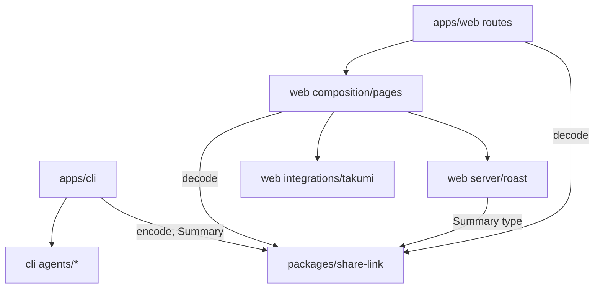

# Plan: Usage Roast Share

Plan for the retained Architecture/SPEC pair of the `usage-roast-share` capability. Plan state: `Complete`. Every task passed its parent Task Gate; see IMPLEMENTATION-NOTES.md.

## Context Pointers

| authority_kind | locator | selector | identity | freshness_rule |
| --- | --- | --- | --- | --- |
| spec | https://github.com/stefan-garofalo/tokenshame/blob/127f8e8d4cddcecc8a15a7d4bbaa8090df6c80df/apps/wiki/content/docs/project/specs/tokenshame/usage-roast-share/SPEC.md | OUT-001..OUT-011, AC-001..AC-043, INV-001..INV-003 | commit `127f8e8d4cddcecc8a15a7d4bbaa8090df6c80df`, sha256 `592fe71e37177ad1…` | Blob bytes at this commit equal the current `SPEC.md`; spec `Architecture Source` names the architecture below |
| architecture | https://github.com/stefan-garofalo/tokenshame/blob/a2cf7b78dbf1ac6d217fb20c4ba4d1837ad5fc87/apps/wiki/content/docs/project/specs/tokenshame/usage-roast-share/ARCHITECTURE.md | ARC-001..ARC-013, FLOW-001..FLOW-004, Spec Traceability | commit `a2cf7b78dbf1ac6d217fb20c4ba4d1837ad5fc87`, sha256 `9ec87f0f1d387934…` | Blob bytes equal the current `ARCHITECTURE.md`; its source hashes match the grill files below |
| grill-log | https://github.com/stefan-garofalo/tokenshame/blob/745075ab2a0eaa9af0eb4519f716d1f3ec084814/apps/wiki/content/docs/project/grilling/tokenshame-grill-log.md | Q1..Q50 (accepted entries; Q15 amendments; Q45 folder superseded by Q50) | commit `745075ab2a0eaa9af0eb4519f716d1f3ec084814`, sha256 `473c7c61e1a3dae3…` | Same bytes; closure line `closed R10` |
| grill-status | https://github.com/stefan-garofalo/tokenshame/blob/745075ab2a0eaa9af0eb4519f716d1f3ec084814/apps/wiki/content/docs/project/grilling/tokenshame-grill-status.md | Closure, Glossary | same commit, sha256 `0e104021acbb12ea…` | Same bytes |
| product-map | https://github.com/stefan-garofalo/tokenshame/blob/d1d802affbe7d4be36be53a47fd70a01df1b800d/apps/wiki/content/docs/project/product/product-map.md | durable identities | commit `d1d802affbe7d4be36be53a47fd70a01df1b800d` | Same bytes |
| backlog | https://github.com/users/stefan-garofalo/projects/7 | project 7, milestone V1 | provider readback of 21 issues, receipt in the delivery log | Re-read before each dispatch |

Each task lists its own spec codes, architecture selectors and source questions below. Workers resolve those pointers and stop on a mismatch.

`architecture_applicability`: **architecture-bearing**. Evidence: a new package (`packages/share-link`) becomes a shared owner for two apps; `apps/web` changes rendering mode and adds routes, composition exports and an integration adapter; `apps/cli` loses its server and gains readers; several tasks cross these ownership boundaries.

`task_identity_mode`: **provider-task**. Each `Tn` is an alias of one GitHub issue (see the alias table). `depends_on` mirrors the native blocked-by links.

## Initial situation

The repo has an Effect CLI that serves the web SPA on `127.0.0.1` (`apps/cli/src/index.ts:reportServer`), a TanStack Start web app in SPA mode with a title-only `head()`, and `packages/ui`. There is no reader, no share-link package, no test runner, no Vercel project. (Architecture S4.)

## Problem statement

Build the usage roast product from the spec: 11 outcomes and 43 acceptance criteria.

## Proposed solution shape

The CLI reads 14 agents locally, builds a Usage Summary and opens a Share Link. A stateless server-rendered web app turns the link into a Share Page and a Share Card. See the architecture's system map and flows (FLOW-001 to FLOW-004).

## Resolved decision ledger

| # | Decision | Source |
| --- | --- | --- |
| D1 | Provider-task mode: tasks are issues #6 to #21 of project 7 | Write Backlog readback |
| D2 | Milestone `V1` for every Story and Task (accepted by the user's "just go" on the recommended name) | backlog |
| D3 | Roast engine lives in `apps/web/src/server/roast/` | log Q50 |
| D4 | One pull request for the one Touched Repository | spec Branch/Base Intent |
| D5 | The design skill runs inside each web page task | log Q48, Q49 |
| D6 | Card route imports only a composition export; `takumi-js` sits in `integrations/takumi` | frontend-layers `route-imports`; log Q39 |
| D7 | The CLI never starts Muse; T7 researches the default folder first, and if none is found no Muse reader ships (AC-018) | log Q29 |
| D8 | npm publish itself needs the user's npm login. The plan proves the tarball and stops short of `npm publish` | spec AC-041 |
| D9 | The Vercel project is created with the user's Vercel CLI login under `stefangarofalos-projects` | user instruction "get this done and working"; backlog Task T15 |

## Assumptions and constraints

- Spec Constraints apply to every task (no network from the CLI, no prompt text, no storage, Node `>=22.13` CLI and `24.x` web, zero CLI runtime dependencies, `tokenshame.vercel.app`).
- Scoped `AGENTS.md` files do not exist for `apps/cli` or `apps/web` (only the root starter). Skills below come from task analysis and the Harness prompt specs, not from scoped tables. Recorded as a risk.
- `bun.lock` is a shared runtime resource: tasks that add dependencies run `bun install` one at a time.

## Dependency Readiness

No Stack Required. (Copied from the spec.) The spec's statement that nothing is unlanded holds only after the **Baseline step** below. External packages are pinned by accepted decisions: `takumi-js` 2.20.0; Nitro version is not recorded, so T9 pins the `nitro` release it verifies builds for Vercel.

## Branch/Base Intent

Not applicable. (Copied from the spec.) One pull request for `stefan-garofalo/tokenshame`; delivery blockers imply no stacked pull requests.

## Baseline step (delivery entry, before W1)

At plan time `main` holds only the initial commit plus the wiki and product files. The pre-existing working tree is still uncommitted: `apps/cli/` (the CLI scaffold), the `.agents`, `.claude`, `.codex`, `.cursor`, `.opencode`, `.devpunks`, `.githooks` folders, `opensrc/`, lint tooling under `apps/*/tools` and `packages/*/tools`, config files, the user's `apps/web` and `packages/ui` edits, and staged renames. Task commits need that base to build. The delivery parent therefore commits it first, in a few scoped commits, after a scan for secrets, machine-local files and large files. It excludes anything local-only and fixes the four lint errors in `header.tsx` and `loader.tsx` that the commit gate reports, changing nothing else in the user's files. This is repository bookkeeping, not a Task. The baseline commit SHA becomes the base of the one pull request.

## Codebase findings

- `apps/web/tools/oxlint/frontend-layers/index.mjs:629` rejects any top-level `src` folder except the layer folders and `server/`. This produced log Q50.
- `apps/cli/oxlint.config.ts` bans barrel imports from `effect`, `typeof` at runtime, object parameters, and symbols with "shape" in the name; lint runs with zero warnings allowed.
- Commit gate: `lefthook.yml` runs `.agents/scripts/commit-gate-runner.mjs`. It lints the paths of each commit: path-limited docs commits passed while the user's staged renames of `header.tsx` and `loader.tsx` (which fail lint today) stayed staged. Every task commits only its own `owned_paths`, so those two files stay out of task commits.
- Grounding probes (not durable): Nitro builds for Vercel with `VERCEL=1`; takumi WASM first image 41 ms; `node:sqlite` read-only reads a live WAL database.

## Wiki Context

**Knowledge used**

| Page | Selected by | Claims used | Freshness | Status and evidence |
| --- | --- | --- | --- | --- |
| [Grill status](https://github.com/stefan-garofalo/tokenshame/blob/745075ab2a0eaa9af0eb4519f716d1f3ec084814/apps/wiki/content/docs/project/grilling/tokenshame-grill-status.md) | Applies when: reading closure, glossary, axioms | Closure `closed R10`; glossary terms; axioms | fresh | Accepted design; compared with the log |
| [Grill log](https://github.com/stefan-garofalo/tokenshame/blob/745075ab2a0eaa9af0eb4519f716d1f3ec084814/apps/wiki/content/docs/project/grilling/tokenshame-grill-log.md) | Applies when: needing an accepted decision | Q1..Q50 | fresh | Accepted design; Q50 checked against `frontend-layers` source |
| [Glossary](https://github.com/stefan-garofalo/tokenshame/blob/d1d802affbe7d4be36be53a47fd70a01df1b800d/apps/wiki/content/docs/project/domains/tokenshame-glossary.mdx) | Applies when: naming domain terms | Terms and axioms (includes AX-5 from Q48) | fresh | Accepted design |
| [Product brief and map](https://github.com/stefan-garofalo/tokenshame/blob/d1d802affbe7d4be36be53a47fd70a01df1b800d/apps/wiki/content/docs/project/product/product-map.md) | Applies when: tracing a backlog object | Durable identities, milestone V1 | fresh | Backlog readback matches |
| [Specs index](https://github.com/stefan-garofalo/tokenshame/blob/d1d802affbe7d4be36be53a47fd70a01df1b800d/apps/wiki/content/docs/project/specs/tokenshame/tokenshame-specs.md) | Applies when: finding the spec | Spec and architecture paths | fresh | Matches the retained pair |

**Stale or contradictory claims**: the architecture, before log Q50, put the roast engine at `apps/web/src/roast/`. Primary evidence (`frontend-layers` rule) disagreed. Resolved by Q50 and the refreshed pair.

**Returned findings**: no-op for `docs-ingest-phase`. Q50 is already in the grill record. The `hi ensure` command is absent from `hi` 6.12.0 although the `hi-cli` skill documents it; that is Harness friction for `hi report`, not project knowledge.

## External research used

Primary sources and probes from grounding: Nitro and TanStack Start deployment skill in `node_modules/@tanstack/react-start`; `takumi-js` 2.20.0 package; Node `node:sqlite` documentation; X card docs (see architecture Validation). `$parallel-research` was used for grounding before the grill closed (two read-only agents) and not repeated here because no new unknown remains.

## Plan control

- `$grilling`: run. The frontier is empty: the pair decides every plan-shaping question. No question was deferred.
- `planning-discovery`: skipped; the grill grounding already covers it.
- `plan-reviewer`: runs before the plan is retained; result in the Review record at the end.

## Alias table

| Task | Provider issue | Story | Milestone |
| --- | --- | --- | --- |
| T1 | [#6 Test tooling: vitest and turbo test](https://github.com/stefan-garofalo/tokenshame/issues/6) | Install it and open it for real | V1 |
| T2 | [#7 Share link package](https://github.com/stefan-garofalo/tokenshame/issues/7) | Run the CLI and see my usage | V1 |
| T3 | [#8 Claude Code reader with stats-cache merge](https://github.com/stefan-garofalo/tokenshame/issues/8) | Run the CLI and see my usage | V1 |
| T4 | [#9 Codex reader](https://github.com/stefan-garofalo/tokenshame/issues/9) | Run the CLI and see my usage | V1 |
| T5 | [#10 opencode reader and SQLite helper](https://github.com/stefan-garofalo/tokenshame/issues/10) | Run the CLI and see my usage | V1 |
| T6 | [#11 Readers for Pi, Gemini CLI, Grok, Qwen, Amp, Droid, Kimi](https://github.com/stefan-garofalo/tokenshame/issues/11) | Run the CLI and see my usage | V1 |
| T7 | [#12 Readers for Copilot CLI, Goose, Antigravity, Muse](https://github.com/stefan-garofalo/tokenshame/issues/12) | Run the CLI and see my usage | V1 |
| T8 | [#13 CLI command, consent prompt, launcher, dry run](https://github.com/stefan-garofalo/tokenshame/issues/13) | Run the CLI and see my usage | V1 |
| T9 | [#14 Server-rendered web app, page tags, root redirect](https://github.com/stefan-garofalo/tokenshame/issues/14) | See my roast on a share page | V1 |
| T10 | [#15 Roast engine](https://github.com/stefan-garofalo/tokenshame/issues/15) | See my roast on a share page | V1 |
| T11 | [#16 Share page and broken-link page](https://github.com/stefan-garofalo/tokenshame/issues/16) | See my roast on a share page | V1 |
| T12 | [#17 Share card route](https://github.com/stefan-garofalo/tokenshame/issues/17) | Share my roast on X | V1 |
| T13 | [#18 Copy image and Post on X buttons](https://github.com/stefan-garofalo/tokenshame/issues/18) | Share my roast on X | V1 |
| T14 | [#19 npm package for the CLI](https://github.com/stefan-garofalo/tokenshame/issues/19) | Install it and open it for real | V1 |
| T15 | [#20 Vercel project and deploy](https://github.com/stefan-garofalo/tokenshame/issues/20) | Install it and open it for real | V1 |
| T16 | [#21 README with project pitch and How we calculate](https://github.com/stefan-garofalo/tokenshame/issues/21) | Install it and open it for real | V1 |

## Target Ownership Topology

```text
packages/share-link        owner of the Share Link format    entry: src/{summary,link,version}.ts   must not absorb: agent reading, roast policy, I/O
apps/cli                   owner of local collection          entry: src/index.ts (bin)               must not absorb: link format, roast policy, any network
  src/agents/*             owner of Usage Source parsing      entry: src/agents/registry.ts           must not absorb: summary logic, prompting
  src/{summary,render,prompt}.ts  CLI composition
apps/web                   owner of the public pages
  src/routes/*             connects composition only          entry: routes/{index,r/$link,r/$link/og[.]png}
  src/composition/routing/pages/{share,share-card}   page templates, composition exports
  src/server/roast         owner of Impact Estimates, prices, lines   entry: index.ts (Server Contract)   must not absorb: UI, I/O, randomness
  src/integrations/takumi  adapter to takumi-js               entry: index.ts                         must not absorb: product policy
```

Source selectors: ARC-001 to ARC-013.

## Declared Dependency Graph



Allowed edges are the arrows. Forbidden static imports: `apps/cli` to `apps/web` and the reverse; `agents/*` to `summary.ts`; any route file to `integrations/` or `server/`; `server/roast` to Node built-ins or `server-only`; `packages/share-link` to either app. Forbidden semantic calls: the CLI making any network request; any code storing a Share Link.
Conclusion: dependencies run one way toward the shared package, and the roast engine and the adapter sit below composition.

## Responsibility Acceptance Criteria

| criterion_id | Owner | Observable assertion | Evidence | due_architecture_wave |
| --- | --- | --- | --- | --- |
| RAC-1 | share-link package | Only `packages/share-link` defines or decodes the Share Link; neither app contains a second schema | `grep` for `StringFromBase64Url` and short-key definitions outside the package returns nothing; link tests pass | A1 |
| RAC-2 | CLI agent readers | Each reader returns usage records from fixtures; no reader imports `summary.ts`, the web app, or a network API | reader tests; import check by lint | A2 |
| RAC-3 | roast engine | `server/roast/index.ts` is pure and the only place with factors, prices, lines | roast tests; no Node built-in or `server-only` import in the folder | A2 |
| RAC-4 | web routing | `apps/web` renders on the server with per-link tags, and route files import only composition | route HTTP tests; `frontend-layers/route-imports` lint | A2 |
| RAC-5 | CLI composition | The command has no server and no network call, and uses the registry and `@tokenshame/share-link` | CLI test with network stubbed to fail; `reportServer` absent | A3 |
| RAC-6 | web composition | The share page template lives in `pages/share/`, passes the design gate, and `frontend-layers` lint | `inspect.mjs`, lint | A3 |
| RAC-7 | card | The route calls a composition export; `takumi-js` is imported only in `integrations/takumi` | grep and lint; PNG test | A4 |
| RAC-8 | distribution | CLI tarball has zero dependencies; production serves page and card; README lists every factor | tarball test; production HTTP; README sync test | A5 |

## Architecture Waves

```text
A1 foundations (T1 test tooling, T2 share-link)
  checkpoint: RAC-1
  A2 collection and web boundary (T3-T7 readers, T9 web routes, T10 roast engine)
    checkpoint: RAC-2, RAC-3, RAC-4, RAC-1 regression
    A3 assembly (T8 CLI command, T11 share page)
      checkpoint: RAC-5, RAC-6, earlier RAC regression
      A4 sharing surface (T12 card, T13 buttons)
        checkpoint: RAC-7, earlier RAC regression
        A5 distribution closure (T14 npm package, T15 Vercel, T16 README)
          final closure: RAC-8, all earlier RAC, empty Migration Ledger
```

Each wave names its topology delta in the task fields. Architecture waves are separate from worker waves (`W1` to `W6`).

## Public Seam Contract

| Seam | Owner | Allowed consumers |
| --- | --- | --- |
| `@tokenshame/share-link` `summary`, `link`, `version` | share-link package | `apps/cli`, `apps/web` |
| Reader interfaces and the registry | CLI agent readers | `apps/cli/src/index.ts` |
| Command entry `tokenshame [--dry-run]` | CLI composition | npm users |
| `server/roast/index.ts` | roast engine | composition pages and the card export |
| Composition exports `SharePage`, `BrokenLinkPage`, `shareCardResponse` | web composition | route files only |
| HTTP routes `/`, `/r/$link`, `/r/$link/og.png` | web routing | browsers, X crawler |

Seam changes return to Requirements Phase.

## Migration Ledger

No temporary seam is planned. The ledger is empty. Removing `reportServer`, the tsdown web copy, and the `web` dev dependency (T8) is a removal, not a temporary seam.

## Parallel execution waves

Each wave is the earliest frontier. Actual release is recomputed after each task gate.

| Wave | Tasks | Why |
| --- | --- | --- |
| W1 | T1 | No blockers |
| W2 | T2 | Blocked by T1 |
| W3 | T3, T4, T5, T6, T9, T10 | Blocked only by T2; write scopes are disjoint (T9 is the only one that touches `bun.lock`) |
| W4 | T7, T11 | T7 needs T5; T11 needs T9 and T10 |
| W5 | T8, T12 | T8 needs T3 to T7; T12 needs T9, T10, T11 |
| W6 | T13, T14, T15, T16 | T13 needs T11 and T12; T14 needs T8; T15 needs T9 and T12; T16 needs T8 and T10 |

Capacity priority: assumption-invalidating work, longest remaining chain (T1 → T2 → T5 → T7 → T8 → T14), unlock count, plan order.

## Task graph

### T1: Test tooling: vitest and turbo test

- **depends_on**: []
- **location**: repo root
- **owned_paths**: [`package.json`, `turbo.json`, `vitest.config.ts`, `apps/cli/package.json`, `apps/cli/src/tooling.test.ts`, `bun.lock`]
- **read_dependencies**: [SPEC.md (AC-043), ARCHITECTURE.md, spec codes [AC-043](https://github.com/stefan-garofalo/tokenshame/blob/127f8e8d4cddcecc8a15a7d4bbaa8090df6c80df/apps/wiki/content/docs/project/specs/tokenshame/usage-roast-share/SPEC.md#ac-043), architecture [ARC-012](https://github.com/stefan-garofalo/tokenshame/blob/a2cf7b78dbf1ac6d217fb20c4ba4d1837ad5fc87/apps/wiki/content/docs/project/specs/tokenshame/usage-roast-share/ARCHITECTURE.md#arc-012), [ARC-013](https://github.com/stefan-garofalo/tokenshame/blob/a2cf7b78dbf1ac6d217fb20c4ba4d1837ad5fc87/apps/wiki/content/docs/project/specs/tokenshame/usage-roast-share/ARCHITECTURE.md#arc-013), source questions Q44, Q46]
- **shared_runtime_resources**: `bun.lock` and `bun install` (exclusive while this task runs); turbo cache.
- **relevant_input_set**: Resolve the Context Pointers above and the selectors named here; hash each `read_dependencies` file before and after the checks; record `bun.lock` hash when dependencies change.
- **wave_boundary**: W1
- **description**: Add `vitest` with `@effect/vitest` and a turbo `test` task so colocated tests and fake-number fixtures run for every workspace. The root `vitest.config.ts` uses a `projects` glob (`apps/*`, `packages/*`) so later packages need no edit. Each workspace gets its own `test` script (`vitest run`); this task adds the one for `apps/cli`. Root-run commands (`bunx vitest run <path>`) and turbo commands use the same tests.
- **validation**: `turbo run test` runs and passes on a first sample test. The green command also runs the checks listed in it.
- **status**: Complete
- **log**: Committed in `1659187` on `feat/usage-roast-share`; parent Task Gate passed (full `turbo run check-types test lint`).
- **files edited/created**: package.json, turbo.json, vitest.config.ts, apps/cli/package.json, apps/cli/src/tooling.test.ts, bun.lock
- **task_identity_mode**: provider-task
- **backlog_item_id**: I_kwDOVqkvrs8AAAABeTe9YA (issue #6)
- **backlog_item_url**: https://github.com/stefan-garofalo/tokenshame/issues/6
- **relation_mode**: native
- **backlog_sync_skip_reason**:
- **assigned_skills**: [`turborepo`, `tdd`]
- **implementation_skill_guidance**:
  - **skill**: `turborepo`
    **applicable_behavior**: Add the `test` task with correct inputs and outputs and no cache of side effects.
  - **skill**: `tdd`
    **applicable_behavior**: Capture the named public-result RED before implementing, keep the GREEN evidence in the task fields, and never add code first.
- **tdd_status**: required
- **tdd_target**: `turbo run test` runs one sample test in `apps/cli`.
- **red_command**: `bunx turbo run test --filter=tokenshame`
- **expected_red_failure**: turbo reports no `test` task, so the command fails.
- **green_command**: `bunx turbo run test --filter=tokenshame`
- **reason_not_testable**: 
- **red_evidence**: `bunx turbo run test --filter=tokenshame`: `Could not find task 'test' in project`, exit 1.
- **green_evidence**: Same command exit 0: 1 test passed; later `turbo run check-types test lint` 11/11.
- **test_form**: example
- **invariant_refs**: [none]
- **sensitivity_evidence**: not_applicable (tooling)
- **codebase_design_notes**: Test surface: the turbo `test` task and one root `vitest.config.ts` `projects` list. No production code.
- **review_mode**: cli
- **runtime_validation**: not_required
- **runtime_target**: not_applicable
- **runtime_evidence**: not_applicable
- **runtime_cleanup**: not_applicable
- **architecture_wave**: A1
- **behavior_owner**: Repository tooling
- **integration_surface**: turbo task graph
- **public_seam**: unchanged
- **topology_delta**: Adds the `test` task all later tasks use.
- **forbidden_ownership**: No product logic in tooling files.
- **temporary_seams**: none
- **responsibility_acceptance_criteria**: [RAC-8]

### T2: Share link package

- **depends_on**: [T1]
- **location**: packages/share-link
- **owned_paths**: [`packages/share-link/**`, `apps/cli/src/agents/types.ts`, `bun.lock`]
- **read_dependencies**: [SPEC.md (AC-007, AC-019, AC-020, AC-021), ARCHITECTURE.md, `T1` outputs, spec codes [AC-007](https://github.com/stefan-garofalo/tokenshame/blob/127f8e8d4cddcecc8a15a7d4bbaa8090df6c80df/apps/wiki/content/docs/project/specs/tokenshame/usage-roast-share/SPEC.md#ac-007), [AC-019](https://github.com/stefan-garofalo/tokenshame/blob/127f8e8d4cddcecc8a15a7d4bbaa8090df6c80df/apps/wiki/content/docs/project/specs/tokenshame/usage-roast-share/SPEC.md#ac-019), [AC-020](https://github.com/stefan-garofalo/tokenshame/blob/127f8e8d4cddcecc8a15a7d4bbaa8090df6c80df/apps/wiki/content/docs/project/specs/tokenshame/usage-roast-share/SPEC.md#ac-020), [AC-021](https://github.com/stefan-garofalo/tokenshame/blob/127f8e8d4cddcecc8a15a7d4bbaa8090df6c80df/apps/wiki/content/docs/project/specs/tokenshame/usage-roast-share/SPEC.md#ac-021), architecture [ARC-003](https://github.com/stefan-garofalo/tokenshame/blob/a2cf7b78dbf1ac6d217fb20c4ba4d1837ad5fc87/apps/wiki/content/docs/project/specs/tokenshame/usage-roast-share/ARCHITECTURE.md#arc-003), [ARC-005](https://github.com/stefan-garofalo/tokenshame/blob/a2cf7b78dbf1ac6d217fb20c4ba4d1837ad5fc87/apps/wiki/content/docs/project/specs/tokenshame/usage-roast-share/ARCHITECTURE.md#arc-005), [FLOW-001-STEP-003](https://github.com/stefan-garofalo/tokenshame/blob/a2cf7b78dbf1ac6d217fb20c4ba4d1837ad5fc87/apps/wiki/content/docs/project/specs/tokenshame/usage-roast-share/ARCHITECTURE.md#flow-001-step-003), [FLOW-002-STEP-001](https://github.com/stefan-garofalo/tokenshame/blob/a2cf7b78dbf1ac6d217fb20c4ba4d1837ad5fc87/apps/wiki/content/docs/project/specs/tokenshame/usage-roast-share/ARCHITECTURE.md#flow-002-step-001), [ARC-010](https://github.com/stefan-garofalo/tokenshame/blob/a2cf7b78dbf1ac6d217fb20c4ba4d1837ad5fc87/apps/wiki/content/docs/project/specs/tokenshame/usage-roast-share/ARCHITECTURE.md#arc-010), source questions Q34, Q42, Q38, Q35]
- **shared_runtime_resources**: `bun.lock` and `bun install` (exclusive).
- **relevant_input_set**: Resolve the Context Pointers above and the selectors named here; hash each `read_dependencies` file before and after the checks; record `bun.lock` hash when dependencies change.
- **wave_boundary**: W2
- **description**: Create `packages/share-link` with the Usage Summary schema, versioned encode and decode (Effect Schema, short-key JSON, base64url, `v: 1`), and committed link fixtures. The CLI bundles it and the web app imports it. Also create `apps/cli/src/agents/types.ts`: the usage record type, the reader signature, and the skipped-source result. It gives T3 to T7 one shared reader contract so they can run in parallel. Provide a fixture link file `packages/share-link/src/fixtures/v1.json` used as the fixture link by later tasks. Add a `check-types` script for the package; the package has no lint scope yet (see Risks).
- **validation**: Round-trip property test, link fixtures for every shipped version, and a worst-case length check. The green command also runs the checks listed in it.
- **status**: Complete
- **log**: Committed in `0ab75eb` on `feat/usage-roast-share`; parent Task Gate passed (full `turbo run check-types test lint`).
- **files edited/created**: packages/share-link/**, apps/cli/src/agents/types.ts, bun.lock
- **task_identity_mode**: provider-task
- **backlog_item_id**: I_kwDOVqkvrs8AAAABeTe_dA (issue #7)
- **backlog_item_url**: https://github.com/stefan-garofalo/tokenshame/issues/7
- **relation_mode**: native
- **backlog_sync_skip_reason**:
- **assigned_skills**: [`effect`, `quality-types`, `codebase-design`, `tdd`]
- **implementation_skill_guidance**:
  - **skill**: `effect`
    **applicable_behavior**: Import by module (`effect/Schema`, `effect/FileSystem`), decode unknown input with Schema, keep failures typed, and do not add services.
  - **skill**: `quality-types`
    **applicable_behavior**: Decode unknown values with Schema, avoid unsafe assertions (a safety comment is mandatory when one is needed), and keep parameter types explicit.
  - **skill**: `codebase-design`
    **applicable_behavior**: Keep the named seam deep and small, and test through its public surface only.
  - **skill**: `tdd`
    **applicable_behavior**: Capture the named public-result RED before implementing, keep the GREEN evidence in the task fields, and never add code first.
- **tdd_status**: required
- **tdd_target**: `decode(encode(summary))` equals `summary` for a sample summary.
- **red_command**: `bunx vitest run packages/share-link/src/link.test.ts`
- **expected_red_failure**: Module `./link` does not exist, so the test file fails to import.
- **green_command**: `bunx vitest run packages/share-link && bunx turbo run check-types --filter=@tokenshame/share-link`
- **reason_not_testable**: 
- **red_evidence**: `bunx vitest run packages/share-link/src/link.test.ts`: `Cannot find module './link'`.
- **green_evidence**: `bunx vitest run packages/share-link` 42/42 and check-types clean; worst-case link 1904 chars.
- **test_form**: property
- **invariant_refs**: [INV-001, INV-003]
- **sensitivity_evidence**: 9 mutants (extra keys, 8-model cap, prose model id, negative, fractional, unknown version, impossible date, hour>23, key collision) each failed a test; restored (worker transcript).
- **codebase_design_notes**: Public seam: `summary.ts` (schema), `link.ts` (`encode`, `decode`, share URL), `version.ts`. Deep module: callers never see base64url or short keys.
- **review_mode**: cli
- **runtime_validation**: not_required
- **runtime_target**: not_applicable
- **runtime_evidence**: not_applicable
- **runtime_cleanup**: not_applicable
- **architecture_wave**: A1
- **behavior_owner**: share-link package
- **integration_surface**: CLI bundle and web server routes
- **public_seam**: New seam `@tokenshame/share-link` with exports `./*` -> `./src/*.ts`; allowed consumers `apps/cli`, `apps/web`.
- **topology_delta**: Creates the sole owner of the Share Link format.
- **forbidden_ownership**: No agent reading, no roast logic, no I/O.
- **temporary_seams**: none
- **responsibility_acceptance_criteria**: [RAC-1]

### T3: Claude Code reader with stats-cache merge

- **depends_on**: [T2]
- **location**: apps/cli/src/agents
- **owned_paths**: [`apps/cli/src/agents/claude.ts`, `apps/cli/src/agents/claude.test.ts`, `apps/cli/src/agents/fixtures/claude/**`]
- **read_dependencies**: [SPEC.md (AC-001, AC-002, AC-005), ARCHITECTURE.md, `T2` outputs, spec codes [AC-001](https://github.com/stefan-garofalo/tokenshame/blob/127f8e8d4cddcecc8a15a7d4bbaa8090df6c80df/apps/wiki/content/docs/project/specs/tokenshame/usage-roast-share/SPEC.md#ac-001), [AC-002](https://github.com/stefan-garofalo/tokenshame/blob/127f8e8d4cddcecc8a15a7d4bbaa8090df6c80df/apps/wiki/content/docs/project/specs/tokenshame/usage-roast-share/SPEC.md#ac-002), [AC-005](https://github.com/stefan-garofalo/tokenshame/blob/127f8e8d4cddcecc8a15a7d4bbaa8090df6c80df/apps/wiki/content/docs/project/specs/tokenshame/usage-roast-share/SPEC.md#ac-005), architecture [ARC-002](https://github.com/stefan-garofalo/tokenshame/blob/a2cf7b78dbf1ac6d217fb20c4ba4d1837ad5fc87/apps/wiki/content/docs/project/specs/tokenshame/usage-roast-share/ARCHITECTURE.md#arc-002), [FLOW-001-STEP-001](https://github.com/stefan-garofalo/tokenshame/blob/a2cf7b78dbf1ac6d217fb20c4ba4d1837ad5fc87/apps/wiki/content/docs/project/specs/tokenshame/usage-roast-share/ARCHITECTURE.md#flow-001-step-001), [FLOW-001-STEP-003](https://github.com/stefan-garofalo/tokenshame/blob/a2cf7b78dbf1ac6d217fb20c4ba4d1837ad5fc87/apps/wiki/content/docs/project/specs/tokenshame/usage-roast-share/ARCHITECTURE.md#flow-001-step-003), [ARC-003](https://github.com/stefan-garofalo/tokenshame/blob/a2cf7b78dbf1ac6d217fb20c4ba4d1837ad5fc87/apps/wiki/content/docs/project/specs/tokenshame/usage-roast-share/ARCHITECTURE.md#arc-003), source questions Q3, Q16, Q44, Q15, Q15a2, Q4]
- **shared_runtime_resources**: none
- **relevant_input_set**: Resolve the Context Pointers above and the selectors named here; hash each `read_dependencies` file before and after the checks; record `bun.lock` hash when dependencies change.
- **wave_boundary**: W3
- **description**: Read Claude Code usage: `stats-cache.json` totals up to `lastComputedDate`, then jsonl logs after that date, with duplicate lines counted once. Use the reader contract in `apps/cli/src/agents/types.ts` from T2.
- **validation**: Fixture tests for duplicates and for the cache-plus-logs merge. The green command also runs the checks listed in it.
- **status**: Complete
- **log**: Committed in `20087ca` on `feat/usage-roast-share`; parent Task Gate passed (full `turbo run check-types test lint`).
- **files edited/created**: apps/cli/src/agents/claude.ts, claude.test.ts, fixtures/claude/**
- **task_identity_mode**: provider-task
- **backlog_item_id**: I_kwDOVqkvrs8AAAABeTfB3Q (issue #8)
- **backlog_item_url**: https://github.com/stefan-garofalo/tokenshame/issues/8
- **relation_mode**: native
- **backlog_sync_skip_reason**:
- **assigned_skills**: [`effect`, `quality-types`, `tdd`]
- **implementation_skill_guidance**:
  - **skill**: `effect`
    **applicable_behavior**: Import by module (`effect/Schema`, `effect/FileSystem`), decode unknown input with Schema, keep failures typed, and do not add services.
  - **skill**: `quality-types`
    **applicable_behavior**: Decode unknown values with Schema, avoid unsafe assertions (a safety comment is mandatory when one is needed), and keep parameter types explicit.
  - **skill**: `tdd`
    **applicable_behavior**: Capture the named public-result RED before implementing, keep the GREEN evidence in the task fields, and never add code first.
- **tdd_status**: required
- **tdd_target**: A jsonl fixture with one `message.id` and `requestId` repeated counts that message once.
- **red_command**: `bunx vitest run apps/cli/src/agents/claude.test.ts`
- **expected_red_failure**: `./claude` does not exist.
- **green_command**: `bunx vitest run apps/cli/src/agents/claude.test.ts && bunx turbo run check-types --filter=tokenshame`
- **reason_not_testable**: 
- **red_evidence**: `./claude` module not found.
- **green_evidence**: 9/9 claude tests; duplicates counted once; cache+logs boundary day counted once.
- **test_form**: example
- **invariant_refs**: [none]
- **sensitivity_evidence**: not run
- **codebase_design_notes**: Reader seam: one plain function (`FileSystem`, `Path`) returning usage records. No services.
- **review_mode**: cli
- **runtime_validation**: not_required
- **runtime_target**: not_applicable
- **runtime_evidence**: not_applicable
- **runtime_cleanup**: not_applicable
- **architecture_wave**: A2
- **behavior_owner**: CLI agent readers
- **integration_surface**: CLI registry
- **public_seam**: Reader interface `readClaude(home)` returning usage records; consumed only by the registry in T8.
- **topology_delta**: Adds one Usage Source reader.
- **forbidden_ownership**: No network, no prompt text kept, no summary logic.
- **temporary_seams**: none
- **responsibility_acceptance_criteria**: [RAC-2]

### T4: Codex reader

- **depends_on**: [T2]
- **location**: apps/cli/src/agents
- **owned_paths**: [`apps/cli/src/agents/codex.ts`, `apps/cli/src/agents/codex.test.ts`, `apps/cli/src/agents/fixtures/codex/**`]
- **read_dependencies**: [SPEC.md (AC-001, AC-003), ARCHITECTURE.md, `T2` outputs, spec codes [AC-001](https://github.com/stefan-garofalo/tokenshame/blob/127f8e8d4cddcecc8a15a7d4bbaa8090df6c80df/apps/wiki/content/docs/project/specs/tokenshame/usage-roast-share/SPEC.md#ac-001), [AC-003](https://github.com/stefan-garofalo/tokenshame/blob/127f8e8d4cddcecc8a15a7d4bbaa8090df6c80df/apps/wiki/content/docs/project/specs/tokenshame/usage-roast-share/SPEC.md#ac-003), architecture [ARC-002](https://github.com/stefan-garofalo/tokenshame/blob/a2cf7b78dbf1ac6d217fb20c4ba4d1837ad5fc87/apps/wiki/content/docs/project/specs/tokenshame/usage-roast-share/ARCHITECTURE.md#arc-002), [FLOW-001-STEP-001](https://github.com/stefan-garofalo/tokenshame/blob/a2cf7b78dbf1ac6d217fb20c4ba4d1837ad5fc87/apps/wiki/content/docs/project/specs/tokenshame/usage-roast-share/ARCHITECTURE.md#flow-001-step-001), [FLOW-001-STEP-003](https://github.com/stefan-garofalo/tokenshame/blob/a2cf7b78dbf1ac6d217fb20c4ba4d1837ad5fc87/apps/wiki/content/docs/project/specs/tokenshame/usage-roast-share/ARCHITECTURE.md#flow-001-step-003), source questions Q3, Q16, Q44]
- **shared_runtime_resources**: none
- **relevant_input_set**: Resolve the Context Pointers above and the selectors named here; hash each `read_dependencies` file before and after the checks; record `bun.lock` hash when dependencies change.
- **wave_boundary**: W3
- **description**: Read Codex sessions and count the last cumulative `token_count` event of each session file. Use the reader contract in `apps/cli/src/agents/types.ts` from T2.
- **validation**: Fixture test with several cumulative events per file. The green command also runs the checks listed in it.
- **status**: Complete
- **log**: Committed in `37bc089` on `feat/usage-roast-share`; parent Task Gate passed (full `turbo run check-types test lint`).
- **files edited/created**: apps/cli/src/agents/codex.ts, codex.test.ts, fixtures/codex/**
- **task_identity_mode**: provider-task
- **backlog_item_id**: I_kwDOVqkvrs8AAAABeTfD_w (issue #9)
- **backlog_item_url**: https://github.com/stefan-garofalo/tokenshame/issues/9
- **relation_mode**: native
- **backlog_sync_skip_reason**:
- **assigned_skills**: [`effect`, `quality-types`, `tdd`]
- **implementation_skill_guidance**:
  - **skill**: `effect`
    **applicable_behavior**: Import by module (`effect/Schema`, `effect/FileSystem`), decode unknown input with Schema, keep failures typed, and do not add services.
  - **skill**: `quality-types`
    **applicable_behavior**: Decode unknown values with Schema, avoid unsafe assertions (a safety comment is mandatory when one is needed), and keep parameter types explicit.
  - **skill**: `tdd`
    **applicable_behavior**: Capture the named public-result RED before implementing, keep the GREEN evidence in the task fields, and never add code first.
- **tdd_status**: required
- **tdd_target**: A session file with three cumulative `token_count` events contributes only the last non-null total.
- **red_command**: `bunx vitest run apps/cli/src/agents/codex.test.ts`
- **expected_red_failure**: `./codex` does not exist.
- **green_command**: `bunx vitest run apps/cli/src/agents/codex.test.ts && bunx turbo run check-types --filter=tokenshame`
- **reason_not_testable**: 
- **red_evidence**: `./codex` module not found.
- **green_evidence**: 9/9 codex tests; real-data check: reader total equals independent jq sum of last totals.
- **test_form**: example
- **invariant_refs**: [none]
- **sensitivity_evidence**: not run
- **codebase_design_notes**: Same reader seam as the other agents.
- **review_mode**: cli
- **runtime_validation**: not_required
- **runtime_target**: not_applicable
- **runtime_evidence**: not_applicable
- **runtime_cleanup**: not_applicable
- **architecture_wave**: A2
- **behavior_owner**: CLI agent readers
- **integration_surface**: CLI registry
- **public_seam**: Reader interface `readCodex(home)`; consumed only by the registry in T8.
- **topology_delta**: Adds one Usage Source reader.
- **forbidden_ownership**: No network, no prompt text kept.
- **temporary_seams**: none
- **responsibility_acceptance_criteria**: [RAC-2]

### T5: opencode reader and SQLite helper

- **depends_on**: [T2]
- **location**: apps/cli/src/agents
- **owned_paths**: [`apps/cli/src/agents/opencode.ts`, `apps/cli/src/agents/opencode.test.ts`, `apps/cli/src/agents/sqlite.ts`, `apps/cli/src/agents/sqlite.test.ts`, `apps/cli/src/agents/fixtures/opencode/**`]
- **read_dependencies**: [SPEC.md (AC-001, AC-004), ARCHITECTURE.md, `T2` outputs, spec codes [AC-001](https://github.com/stefan-garofalo/tokenshame/blob/127f8e8d4cddcecc8a15a7d4bbaa8090df6c80df/apps/wiki/content/docs/project/specs/tokenshame/usage-roast-share/SPEC.md#ac-001), [AC-004](https://github.com/stefan-garofalo/tokenshame/blob/127f8e8d4cddcecc8a15a7d4bbaa8090df6c80df/apps/wiki/content/docs/project/specs/tokenshame/usage-roast-share/SPEC.md#ac-004), architecture [ARC-002](https://github.com/stefan-garofalo/tokenshame/blob/a2cf7b78dbf1ac6d217fb20c4ba4d1837ad5fc87/apps/wiki/content/docs/project/specs/tokenshame/usage-roast-share/ARCHITECTURE.md#arc-002), [FLOW-001-STEP-001](https://github.com/stefan-garofalo/tokenshame/blob/a2cf7b78dbf1ac6d217fb20c4ba4d1837ad5fc87/apps/wiki/content/docs/project/specs/tokenshame/usage-roast-share/ARCHITECTURE.md#flow-001-step-001), [FLOW-001-STEP-003](https://github.com/stefan-garofalo/tokenshame/blob/a2cf7b78dbf1ac6d217fb20c4ba4d1837ad5fc87/apps/wiki/content/docs/project/specs/tokenshame/usage-roast-share/ARCHITECTURE.md#flow-001-step-003), source questions Q3, Q16, Q37]
- **shared_runtime_resources**: Fixture SQLite databases created per test in a temp folder.
- **relevant_input_set**: Resolve the Context Pointers above and the selectors named here; hash each `read_dependencies` file before and after the checks; record `bun.lock` hash when dependencies change.
- **wave_boundary**: W3
- **description**: Read the opencode database with a shared read-only `node:sqlite` helper, counting session or message totals but never both. Use the reader contract in `apps/cli/src/agents/types.ts` from T2.
- **validation**: Fixture database test, including a database with a live write-ahead log. The green command also runs the checks listed in it.
- **status**: Complete
- **log**: Committed in `f27bbfa` on `feat/usage-roast-share`; parent Task Gate passed (full `turbo run check-types test lint`).
- **files edited/created**: apps/cli/src/agents/opencode.ts, opencode.test.ts, sqlite.ts, sqlite.test.ts
- **task_identity_mode**: provider-task
- **backlog_item_id**: I_kwDOVqkvrs8AAAABeTfGDA (issue #10)
- **backlog_item_url**: https://github.com/stefan-garofalo/tokenshame/issues/10
- **relation_mode**: native
- **backlog_sync_skip_reason**:
- **assigned_skills**: [`effect`, `quality-types`, `codebase-design`, `tdd`]
- **implementation_skill_guidance**:
  - **skill**: `effect`
    **applicable_behavior**: Import by module (`effect/Schema`, `effect/FileSystem`), decode unknown input with Schema, keep failures typed, and do not add services.
  - **skill**: `quality-types`
    **applicable_behavior**: Decode unknown values with Schema, avoid unsafe assertions (a safety comment is mandatory when one is needed), and keep parameter types explicit.
  - **skill**: `codebase-design`
    **applicable_behavior**: Keep the named seam deep and small, and test through its public surface only.
  - **skill**: `tdd`
    **applicable_behavior**: Capture the named public-result RED before implementing, keep the GREEN evidence in the task fields, and never add code first.
- **tdd_status**: required
- **tdd_target**: A database whose `session` and `message` rows agree is counted once, not twice.
- **red_command**: `bunx vitest run apps/cli/src/agents/opencode.test.ts apps/cli/src/agents/sqlite.test.ts`
- **expected_red_failure**: `./opencode` and `./sqlite` do not exist.
- **green_command**: `bunx vitest run apps/cli/src/agents/opencode.test.ts apps/cli/src/agents/sqlite.test.ts && bunx turbo run check-types --filter=tokenshame`
- **reason_not_testable**: 
- **red_evidence**: `./opencode` and `./sqlite` not found.
- **green_evidence**: 16/16 tests incl. live WAL, locked, corrupt; real db totals matched.
- **test_form**: example
- **invariant_refs**: [none]
- **sensitivity_evidence**: Concatenating session and message sources failed 3 tests (doubled totals); restored.
- **codebase_design_notes**: Adapter: `agents/sqlite.ts` wraps `node:sqlite` `DatabaseSync(path, { readOnly: true })` and returns a skipped-source result on open failure. It is the seam for the SQLite readers.
- **review_mode**: cli
- **runtime_validation**: not_required
- **runtime_target**: not_applicable
- **runtime_evidence**: not_applicable
- **runtime_cleanup**: not_applicable
- **architecture_wave**: A2
- **behavior_owner**: CLI agent readers
- **integration_surface**: CLI registry
- **public_seam**: `openReadOnly(path)` helper consumed by T5 and T7.
- **topology_delta**: Adds the shared SQLite adapter and one reader.
- **forbidden_ownership**: No write access to any agent database; no `?immutable=1`.
- **temporary_seams**: none
- **responsibility_acceptance_criteria**: [RAC-2]

### T6: Readers for Pi, Gemini CLI, Grok, Qwen, Amp, Droid, Kimi

- **depends_on**: [T2]
- **location**: apps/cli/src/agents
- **owned_paths**: [`apps/cli/src/agents/pi.ts`, `apps/cli/src/agents/gemini.ts`, `apps/cli/src/agents/grok.ts`, `apps/cli/src/agents/qwen.ts`, `apps/cli/src/agents/amp.ts`, `apps/cli/src/agents/droid.ts`, `apps/cli/src/agents/kimi.ts`, `apps/cli/src/agents/json-agents.test.ts`, `apps/cli/src/agents/fixtures/json-agents/**`]
- **read_dependencies**: [SPEC.md (AC-001, AC-006), ARCHITECTURE.md, `T2` outputs, spec codes [AC-001](https://github.com/stefan-garofalo/tokenshame/blob/127f8e8d4cddcecc8a15a7d4bbaa8090df6c80df/apps/wiki/content/docs/project/specs/tokenshame/usage-roast-share/SPEC.md#ac-001), [AC-006](https://github.com/stefan-garofalo/tokenshame/blob/127f8e8d4cddcecc8a15a7d4bbaa8090df6c80df/apps/wiki/content/docs/project/specs/tokenshame/usage-roast-share/SPEC.md#ac-006), architecture [ARC-002](https://github.com/stefan-garofalo/tokenshame/blob/a2cf7b78dbf1ac6d217fb20c4ba4d1837ad5fc87/apps/wiki/content/docs/project/specs/tokenshame/usage-roast-share/ARCHITECTURE.md#arc-002), [FLOW-001-STEP-001](https://github.com/stefan-garofalo/tokenshame/blob/a2cf7b78dbf1ac6d217fb20c4ba4d1837ad5fc87/apps/wiki/content/docs/project/specs/tokenshame/usage-roast-share/ARCHITECTURE.md#flow-001-step-001), source questions Q3, Q16]
- **shared_runtime_resources**: none
- **relevant_input_set**: Resolve the Context Pointers above and the selectors named here; hash each `read_dependencies` file before and after the checks; record `bun.lock` hash when dependencies change.
- **wave_boundary**: W3
- **description**: Add one plain reader for each of these seven agents that keep token data in JSON or jsonl files. Cursor, Kiro, Devin, and the T3 Code scan cache are never read. Use the reader contract in `apps/cli/src/agents/types.ts` from T2.
- **validation**: One fixture test per agent. The green command also runs the checks listed in it.
- **status**: Complete
- **log**: Committed in `92e5fad` on `feat/usage-roast-share`; parent Task Gate passed (full `turbo run check-types test lint`).
- **files edited/created**: apps/cli/src/agents/{pi,gemini,grok,qwen,amp,droid,kimi}.ts, json-agents.test.ts, fixtures/json-agents/**
- **task_identity_mode**: provider-task
- **backlog_item_id**: I_kwDOVqkvrs8AAAABeTfKVw (issue #11)
- **backlog_item_url**: https://github.com/stefan-garofalo/tokenshame/issues/11
- **relation_mode**: native
- **backlog_sync_skip_reason**:
- **assigned_skills**: [`effect`, `quality-types`, `tdd`]
- **implementation_skill_guidance**:
  - **skill**: `effect`
    **applicable_behavior**: Import by module (`effect/Schema`, `effect/FileSystem`), decode unknown input with Schema, keep failures typed, and do not add services.
  - **skill**: `quality-types`
    **applicable_behavior**: Decode unknown values with Schema, avoid unsafe assertions (a safety comment is mandatory when one is needed), and keep parameter types explicit.
  - **skill**: `tdd`
    **applicable_behavior**: Capture the named public-result RED before implementing, keep the GREEN evidence in the task fields, and never add code first.
- **tdd_status**: required
- **tdd_target**: Each of the seven fixtures yields its known per-model totals.
- **red_command**: `bunx vitest run apps/cli/src/agents/json-agents.test.ts`
- **expected_red_failure**: The seven reader modules do not exist.
- **green_command**: `bunx vitest run apps/cli/src/agents/json-agents.test.ts && bunx turbo run check-types --filter=tokenshame`
- **reason_not_testable**: 
- **red_evidence**: `./amp` module not found.
- **green_evidence**: 28/28 fixture tests (7 agents).
- **test_form**: example
- **invariant_refs**: [none]
- **sensitivity_evidence**: Dropping Gemini thoughts and Kimi message_id dedupe failed 4 tests; restored.
- **codebase_design_notes**: Seven small readers behind the same reader seam; shared parsing stays inside each file unless two readers repeat the same block.
- **review_mode**: cli
- **runtime_validation**: not_required
- **runtime_target**: not_applicable
- **runtime_evidence**: not_applicable
- **runtime_cleanup**: not_applicable
- **architecture_wave**: A2
- **behavior_owner**: CLI agent readers
- **integration_surface**: CLI registry
- **public_seam**: Seven reader interfaces consumed only by the registry in T8.
- **topology_delta**: Adds seven Usage Source readers.
- **forbidden_ownership**: No reader for Cursor, Kiro, Devin, or the T3 Code scan cache.
- **temporary_seams**: none
- **responsibility_acceptance_criteria**: [RAC-2]

### T7: Readers for Copilot CLI, Goose, Antigravity, Muse

- **depends_on**: [T5]
- **location**: apps/cli/src/agents
- **owned_paths**: [`apps/cli/src/agents/copilot.ts`, `apps/cli/src/agents/goose.ts`, `apps/cli/src/agents/antigravity.ts`, `apps/cli/src/agents/muse.ts`, `apps/cli/src/agents/protobuf.ts`, `apps/cli/src/agents/sqlite-agents.test.ts`, `apps/cli/src/agents/fixtures/sqlite-agents/**`]
- **read_dependencies**: [SPEC.md (AC-001, AC-018), ARCHITECTURE.md, `T5` outputs, spec codes [AC-001](https://github.com/stefan-garofalo/tokenshame/blob/127f8e8d4cddcecc8a15a7d4bbaa8090df6c80df/apps/wiki/content/docs/project/specs/tokenshame/usage-roast-share/SPEC.md#ac-001), [AC-018](https://github.com/stefan-garofalo/tokenshame/blob/127f8e8d4cddcecc8a15a7d4bbaa8090df6c80df/apps/wiki/content/docs/project/specs/tokenshame/usage-roast-share/SPEC.md#ac-018), architecture [ARC-002](https://github.com/stefan-garofalo/tokenshame/blob/a2cf7b78dbf1ac6d217fb20c4ba4d1837ad5fc87/apps/wiki/content/docs/project/specs/tokenshame/usage-roast-share/ARCHITECTURE.md#arc-002), [FLOW-001-STEP-001](https://github.com/stefan-garofalo/tokenshame/blob/a2cf7b78dbf1ac6d217fb20c4ba4d1837ad5fc87/apps/wiki/content/docs/project/specs/tokenshame/usage-roast-share/ARCHITECTURE.md#flow-001-step-001), source questions Q3, Q16, Q29]
- **shared_runtime_resources**: Fixture SQLite databases created per test in a temp folder.
- **relevant_input_set**: Resolve the Context Pointers above and the selectors named here; hash each `read_dependencies` file before and after the checks; record `bun.lock` hash when dependencies change.
- **wave_boundary**: W4
- **description**: Add readers for the four agents that need SQLite or a special folder rule: Copilot CLI, Goose, Antigravity (small hand-written protobuf decoder), and Muse (default folder or `MUSE_HOME`; never start Muse). Use the reader contract in `apps/cli/src/agents/types.ts` from T2. First research the Muse default home folder (the T3 Code source `packages/provider-muse` reads it from the running Muse); if none is found, ship no Muse reader and record that (AC-018).
- **validation**: Fixture tests, and a test for the Muse folder rule. The green command also runs the checks listed in it.
- **status**: Complete
- **log**: Committed in `2a9c2c8` on `feat/usage-roast-share`; parent Task Gate passed (full `turbo run check-types test lint`).
- **files edited/created**: apps/cli/src/agents/{copilot,goose,antigravity,muse,protobuf}.ts, sqlite-agents.test.ts
- **task_identity_mode**: provider-task
- **backlog_item_id**: I_kwDOVqkvrs8AAAABeTfMOQ (issue #12)
- **backlog_item_url**: https://github.com/stefan-garofalo/tokenshame/issues/12
- **relation_mode**: native
- **backlog_sync_skip_reason**:
- **assigned_skills**: [`effect`, `quality-types`, `codebase-design`, `tdd`]
- **implementation_skill_guidance**:
  - **skill**: `effect`
    **applicable_behavior**: Import by module (`effect/Schema`, `effect/FileSystem`), decode unknown input with Schema, keep failures typed, and do not add services.
  - **skill**: `quality-types`
    **applicable_behavior**: Decode unknown values with Schema, avoid unsafe assertions (a safety comment is mandatory when one is needed), and keep parameter types explicit.
  - **skill**: `codebase-design`
    **applicable_behavior**: Keep the named seam deep and small, and test through its public surface only.
  - **skill**: `tdd`
    **applicable_behavior**: Capture the named public-result RED before implementing, keep the GREEN evidence in the task fields, and never add code first.
- **tdd_status**: required
- **tdd_target**: A Copilot CLI fixture database yields its known totals; Muse is skipped when no folder and no `MUSE_HOME` exist.
- **red_command**: `bunx vitest run apps/cli/src/agents/sqlite-agents.test.ts`
- **expected_red_failure**: The four reader modules and `protobuf` do not exist.
- **green_command**: `bunx vitest run apps/cli/src/agents/sqlite-agents.test.ts && bunx turbo run check-types --filter=tokenshame`
- **reason_not_testable**: 
- **red_evidence**: `./antigravity` module not found.
- **green_evidence**: 31/31 sqlite-agents tests (Copilot, Goose, Antigravity, Muse); Muse skipped without folder.
- **test_form**: example
- **invariant_refs**: [none]
- **sensitivity_evidence**: not run
- **codebase_design_notes**: Reuse `openReadOnly` from T5. `protobuf.ts` is a private helper decoding only the usage fields the grill accepted.
- **review_mode**: cli
- **runtime_validation**: not_required
- **runtime_target**: not_applicable
- **runtime_evidence**: not_applicable
- **runtime_cleanup**: not_applicable
- **architecture_wave**: A2
- **behavior_owner**: CLI agent readers
- **integration_surface**: CLI registry
- **public_seam**: Four reader interfaces consumed by the registry in T8; `protobuf.ts` stays private to `antigravity.ts`.
- **topology_delta**: Adds four Usage Source readers.
- **forbidden_ownership**: Never start the Muse program; no protobuf library.
- **temporary_seams**: none
- **responsibility_acceptance_criteria**: [RAC-2]

### T8: CLI command, consent prompt, launcher, dry run

- **depends_on**: [T3, T4, T5, T6, T7]
- **location**: apps/cli
- **owned_paths**: [`apps/cli/src/index.ts`, `apps/cli/src/summary.ts`, `apps/cli/src/render.ts`, `apps/cli/src/prompt.ts`, `apps/cli/src/agents/registry.ts`, `apps/cli/src/cli.test.ts`, `apps/cli/tsdown.config.ts`, `apps/cli/package.json`]
- **read_dependencies**: [SPEC.md (AC-008, AC-009, AC-010, AC-011, AC-012, AC-013, AC-014, AC-015, AC-016, AC-017, AC-007), ARCHITECTURE.md, `T3` outputs, `T4` outputs, `T5` outputs, `T6` outputs, `T7` outputs, spec codes [AC-008](https://github.com/stefan-garofalo/tokenshame/blob/127f8e8d4cddcecc8a15a7d4bbaa8090df6c80df/apps/wiki/content/docs/project/specs/tokenshame/usage-roast-share/SPEC.md#ac-008), [AC-009](https://github.com/stefan-garofalo/tokenshame/blob/127f8e8d4cddcecc8a15a7d4bbaa8090df6c80df/apps/wiki/content/docs/project/specs/tokenshame/usage-roast-share/SPEC.md#ac-009), [AC-010](https://github.com/stefan-garofalo/tokenshame/blob/127f8e8d4cddcecc8a15a7d4bbaa8090df6c80df/apps/wiki/content/docs/project/specs/tokenshame/usage-roast-share/SPEC.md#ac-010), [AC-011](https://github.com/stefan-garofalo/tokenshame/blob/127f8e8d4cddcecc8a15a7d4bbaa8090df6c80df/apps/wiki/content/docs/project/specs/tokenshame/usage-roast-share/SPEC.md#ac-011), [AC-012](https://github.com/stefan-garofalo/tokenshame/blob/127f8e8d4cddcecc8a15a7d4bbaa8090df6c80df/apps/wiki/content/docs/project/specs/tokenshame/usage-roast-share/SPEC.md#ac-012), [AC-013](https://github.com/stefan-garofalo/tokenshame/blob/127f8e8d4cddcecc8a15a7d4bbaa8090df6c80df/apps/wiki/content/docs/project/specs/tokenshame/usage-roast-share/SPEC.md#ac-013), [AC-014](https://github.com/stefan-garofalo/tokenshame/blob/127f8e8d4cddcecc8a15a7d4bbaa8090df6c80df/apps/wiki/content/docs/project/specs/tokenshame/usage-roast-share/SPEC.md#ac-014), [AC-015](https://github.com/stefan-garofalo/tokenshame/blob/127f8e8d4cddcecc8a15a7d4bbaa8090df6c80df/apps/wiki/content/docs/project/specs/tokenshame/usage-roast-share/SPEC.md#ac-015), [AC-016](https://github.com/stefan-garofalo/tokenshame/blob/127f8e8d4cddcecc8a15a7d4bbaa8090df6c80df/apps/wiki/content/docs/project/specs/tokenshame/usage-roast-share/SPEC.md#ac-016), [AC-017](https://github.com/stefan-garofalo/tokenshame/blob/127f8e8d4cddcecc8a15a7d4bbaa8090df6c80df/apps/wiki/content/docs/project/specs/tokenshame/usage-roast-share/SPEC.md#ac-017), [AC-007](https://github.com/stefan-garofalo/tokenshame/blob/127f8e8d4cddcecc8a15a7d4bbaa8090df6c80df/apps/wiki/content/docs/project/specs/tokenshame/usage-roast-share/SPEC.md#ac-007), architecture [ARC-003](https://github.com/stefan-garofalo/tokenshame/blob/a2cf7b78dbf1ac6d217fb20c4ba4d1837ad5fc87/apps/wiki/content/docs/project/specs/tokenshame/usage-roast-share/ARCHITECTURE.md#arc-003), [FLOW-001-STEP-003](https://github.com/stefan-garofalo/tokenshame/blob/a2cf7b78dbf1ac6d217fb20c4ba4d1837ad5fc87/apps/wiki/content/docs/project/specs/tokenshame/usage-roast-share/ARCHITECTURE.md#flow-001-step-003), [ARC-001](https://github.com/stefan-garofalo/tokenshame/blob/a2cf7b78dbf1ac6d217fb20c4ba4d1837ad5fc87/apps/wiki/content/docs/project/specs/tokenshame/usage-roast-share/ARCHITECTURE.md#arc-001), [ARC-002](https://github.com/stefan-garofalo/tokenshame/blob/a2cf7b78dbf1ac6d217fb20c4ba4d1837ad5fc87/apps/wiki/content/docs/project/specs/tokenshame/usage-roast-share/ARCHITECTURE.md#arc-002), [ARC-013](https://github.com/stefan-garofalo/tokenshame/blob/a2cf7b78dbf1ac6d217fb20c4ba4d1837ad5fc87/apps/wiki/content/docs/project/specs/tokenshame/usage-roast-share/ARCHITECTURE.md#arc-013), [ARC-004](https://github.com/stefan-garofalo/tokenshame/blob/a2cf7b78dbf1ac6d217fb20c4ba4d1837ad5fc87/apps/wiki/content/docs/project/specs/tokenshame/usage-roast-share/ARCHITECTURE.md#arc-004), [FLOW-001-STEP-004](https://github.com/stefan-garofalo/tokenshame/blob/a2cf7b78dbf1ac6d217fb20c4ba4d1837ad5fc87/apps/wiki/content/docs/project/specs/tokenshame/usage-roast-share/ARCHITECTURE.md#flow-001-step-004), [FLOW-001-STEP-005](https://github.com/stefan-garofalo/tokenshame/blob/a2cf7b78dbf1ac6d217fb20c4ba4d1837ad5fc87/apps/wiki/content/docs/project/specs/tokenshame/usage-roast-share/ARCHITECTURE.md#flow-001-step-005), [FLOW-001-STEP-006](https://github.com/stefan-garofalo/tokenshame/blob/a2cf7b78dbf1ac6d217fb20c4ba4d1837ad5fc87/apps/wiki/content/docs/project/specs/tokenshame/usage-roast-share/ARCHITECTURE.md#flow-001-step-006), [FLOW-001-STEP-002](https://github.com/stefan-garofalo/tokenshame/blob/a2cf7b78dbf1ac6d217fb20c4ba4d1837ad5fc87/apps/wiki/content/docs/project/specs/tokenshame/usage-roast-share/ARCHITECTURE.md#flow-001-step-002), [ARC-005](https://github.com/stefan-garofalo/tokenshame/blob/a2cf7b78dbf1ac6d217fb20c4ba4d1837ad5fc87/apps/wiki/content/docs/project/specs/tokenshame/usage-roast-share/ARCHITECTURE.md#arc-005), source questions Q4, Q26, Q7, Q37, Q5, Q22, Q27, Q43, Q34, Q42]
- **shared_runtime_resources**: `bun.lock`: T8 and T12 never write it at the same time; the one that finishes second re-runs `bun install` and commits the lock change. Stubbed opener and stubbed network in tests.
- **relevant_input_set**: Resolve the Context Pointers above and the selectors named here; hash each `read_dependencies` file before and after the checks; record `bun.lock` hash when dependencies change.
- **wave_boundary**: W5
- **description**: Build the CLI command: registry of all readers, Usage Summary builder (top 8 models plus other, sessions, busiest hour, first day), exact summary print, Enter to open the link, `--dry-run`, skipped-source messages, no-logs exit, narrow SQLite warning filter. Remove `reportServer`, the web build copy, and the `web` dev dependency. The launcher that starts `open`, `xdg-open`, or `start` lives in `prompt.ts` (accepted layout). In `apps/cli/package.json`: add `@tokenshame/share-link` as a **devDependency** (tsdown inlines it; a `dependencies` entry would stay external), remove the `web` devDependency, remove the stale `--port 4747` from the `dev` script, and set `engines.node` to `>=22.13`. `@tokenshame/share-link` is reached through T3 to T7 to T2; this task also reads T2 outputs directly.
- **validation**: CLI entry test with a fake home folder, a stubbed opener, and network calls stubbed to fail. The green command also runs the checks listed in it.
- **status**: Complete
- **log**: Committed in `6d2c12d` on `feat/usage-roast-share`; parent Task Gate passed (full `turbo run check-types test lint`).
- **files edited/created**: apps/cli/src/{index,summary,render,prompt}.ts, agents/registry.ts, cli.test.ts, tsdown.config.ts, package.json, bun.lock
- **task_identity_mode**: provider-task
- **backlog_item_id**: I_kwDOVqkvrs8AAAABeTfOiQ (issue #13)
- **backlog_item_url**: https://github.com/stefan-garofalo/tokenshame/issues/13
- **relation_mode**: native
- **backlog_sync_skip_reason**:
- **assigned_skills**: [`effect`, `quality-types`, `codebase-design`, `tdd`]
- **implementation_skill_guidance**:
  - **skill**: `effect`
    **applicable_behavior**: Import by module (`effect/Schema`, `effect/FileSystem`), decode unknown input with Schema, keep failures typed, and do not add services.
  - **skill**: `quality-types`
    **applicable_behavior**: Decode unknown values with Schema, avoid unsafe assertions (a safety comment is mandatory when one is needed), and keep parameter types explicit.
  - **skill**: `codebase-design`
    **applicable_behavior**: Keep the named seam deep and small, and test through its public surface only.
  - **skill**: `tdd`
    **applicable_behavior**: Capture the named public-result RED before implementing, keep the GREEN evidence in the task fields, and never add code first.
- **tdd_status**: required
- **tdd_target**: A dry run with a fake home prints the exact Usage Summary and link, and starts no opener.
- **red_command**: `bunx vitest run apps/cli/src/cli.test.ts`
- **expected_red_failure**: `./summary`, `./render`, `./prompt`, and the registry do not exist; the old `reportServer` still binds a port.
- **green_command**: `bunx vitest run apps/cli && bunx turbo run check-types lint --filter=tokenshame`
- **reason_not_testable**: 
- **red_evidence**: `Cannot find package '@tokenshame/share-link/link'` and missing modules.
- **green_evidence**: 19 new CLI tests; built CLI dry run on fixture home and on real logs prints the summary and link; no bare imports in dist.
- **test_form**: example
- **invariant_refs**: [INV-002, INV-001]
- **sensitivity_evidence**: not run
- **codebase_design_notes**: Public seam is the command entry. `summary.ts` is pure; `prompt.ts` is the only code that spawns the opener. The registry is the single list of readers.
- **review_mode**: cli
- **runtime_validation**: not_required
- **runtime_target**: not_applicable
- **runtime_evidence**: not_applicable
- **runtime_cleanup**: not_applicable
- **architecture_wave**: A3
- **behavior_owner**: CLI composition
- **integration_surface**: npm bin `tokenshame`
- **public_seam**: Command entry `tokenshame [--dry-run]`; consumes `@tokenshame/share-link`.
- **topology_delta**: Removes `reportServer`, the web copy, and the `web` dev dependency; adds the share-link dependency.
- **forbidden_ownership**: No HTTP server, no network request, no copy of the web build.
- **temporary_seams**: none
- **responsibility_acceptance_criteria**: [RAC-5, RAC-1]

### T9: Server-rendered web app, page tags, root redirect

- **depends_on**: [T2]
- **location**: apps/web
- **owned_paths**: [`apps/web/vite.config.ts`, `apps/web/package.json`, `apps/web/.env.schema`, `apps/web/src/env.ts`, `apps/web/src/routes/index.tsx`, `apps/web/src/routes/r/$link.tsx`, `apps/web/src/composition/routing/pages/share/index.ts`, `apps/web/src/composition/routing/pages/share/share-route.ts`, `apps/web/tests/http-harness.ts`, `apps/web/tests/routes.test.ts`, `bun.lock`]
- **read_dependencies**: [SPEC.md (AC-023, AC-025, AC-038, AC-042), ARCHITECTURE.md, `T2` outputs, spec codes [AC-023](https://github.com/stefan-garofalo/tokenshame/blob/127f8e8d4cddcecc8a15a7d4bbaa8090df6c80df/apps/wiki/content/docs/project/specs/tokenshame/usage-roast-share/SPEC.md#ac-023), [AC-025](https://github.com/stefan-garofalo/tokenshame/blob/127f8e8d4cddcecc8a15a7d4bbaa8090df6c80df/apps/wiki/content/docs/project/specs/tokenshame/usage-roast-share/SPEC.md#ac-025), [AC-038](https://github.com/stefan-garofalo/tokenshame/blob/127f8e8d4cddcecc8a15a7d4bbaa8090df6c80df/apps/wiki/content/docs/project/specs/tokenshame/usage-roast-share/SPEC.md#ac-038), [AC-042](https://github.com/stefan-garofalo/tokenshame/blob/127f8e8d4cddcecc8a15a7d4bbaa8090df6c80df/apps/wiki/content/docs/project/specs/tokenshame/usage-roast-share/SPEC.md#ac-042), architecture [ARC-007](https://github.com/stefan-garofalo/tokenshame/blob/a2cf7b78dbf1ac6d217fb20c4ba4d1837ad5fc87/apps/wiki/content/docs/project/specs/tokenshame/usage-roast-share/ARCHITECTURE.md#arc-007), [FLOW-002-STEP-003](https://github.com/stefan-garofalo/tokenshame/blob/a2cf7b78dbf1ac6d217fb20c4ba4d1837ad5fc87/apps/wiki/content/docs/project/specs/tokenshame/usage-roast-share/ARCHITECTURE.md#flow-002-step-003), [FLOW-003-STEP-001](https://github.com/stefan-garofalo/tokenshame/blob/a2cf7b78dbf1ac6d217fb20c4ba4d1837ad5fc87/apps/wiki/content/docs/project/specs/tokenshame/usage-roast-share/ARCHITECTURE.md#flow-003-step-001), [ARC-009](https://github.com/stefan-garofalo/tokenshame/blob/a2cf7b78dbf1ac6d217fb20c4ba4d1837ad5fc87/apps/wiki/content/docs/project/specs/tokenshame/usage-roast-share/ARCHITECTURE.md#arc-009), [ARC-006](https://github.com/stefan-garofalo/tokenshame/blob/a2cf7b78dbf1ac6d217fb20c4ba4d1837ad5fc87/apps/wiki/content/docs/project/specs/tokenshame/usage-roast-share/ARCHITECTURE.md#arc-006), [ARC-013](https://github.com/stefan-garofalo/tokenshame/blob/a2cf7b78dbf1ac6d217fb20c4ba4d1837ad5fc87/apps/wiki/content/docs/project/specs/tokenshame/usage-roast-share/ARCHITECTURE.md#arc-013), source questions Q18, Q36, Q40, Q41, Q17, Q46, Q47, Q23]
- **shared_runtime_resources**: `bun.lock` (exclusive); local dev server port 3001 during HTTP tests.
- **relevant_input_set**: Resolve the Context Pointers above and the selectors named here; hash each `read_dependencies` file before and after the checks; record `bun.lock` hash when dependencies change.
- **wave_boundary**: W3
- **description**: Switch `apps/web` from SPA mode to server rendering with Nitro for Vercel (`engines.node` `24.x`), add the `/` redirect (308 to GitHub), the `/r/$link` route with per-link tags, and the site address from `VERCEL_PROJECT_PRODUCTION_URL`. Route files only connect composition: `routes/r/$link.tsx` imports `shareRoute` from the composition export `pages/share/index.ts`, which owns the loader (decode), `head()` and `headers()`. At this stage `head()` carries generic title and description plus the absolute `og:image` and `twitter:image`; T11 refines them with the roast headline. The component is a minimal stub that T11 replaces in place (the export is final, so it is not a temporary seam). Add the web `test` script, `engines.node` `24.x`, the pinned `nitro` release, and `tests/http-harness.ts` (starts the built server for HTTP tests; T12 reuses it).
- **validation**: HTTP tests of `/` and of the server-rendered HTML of `/r/<link>` without scripts. The green command also runs the checks listed in it.
- **status**: Complete
- **log**: Committed in `8936540` on `feat/usage-roast-share`; parent Task Gate passed (full `turbo run check-types test lint`).
- **files edited/created**: apps/web/{vite.config.ts,package.json,.env.schema}, routes/index.tsx, routes/r/$link.tsx, pages/share/{index,share-route}.ts, tests/{http-harness,routes.test}.ts, bun.lock
- **task_identity_mode**: provider-task
- **backlog_item_id**: I_kwDOVqkvrs8AAAABeTfQtw (issue #14)
- **backlog_item_url**: https://github.com/stefan-garofalo/tokenshame/issues/14
- **relation_mode**: native
- **backlog_sync_skip_reason**:
- **assigned_skills**: [`frontend-domain-structure`, `seo-audit`, `tdd`]
- **implementation_skill_guidance**:
  - **skill**: `frontend-domain-structure`
    **applicable_behavior**: Place code in the fixed web layers, keep route files importing only composition, and run the `frontend-layers` lint rules on the changed files.
  - **skill**: `seo-audit`
    **applicable_behavior**: Check the per-link title, description, `og:*`, and Twitter tags in the server-rendered HTML, and keep `robots` at `noindex`.
  - **skill**: `tdd`
    **applicable_behavior**: Capture the named public-result RED before implementing, keep the GREEN evidence in the task fields, and never add code first.
- **tdd_status**: required
- **tdd_target**: `GET /` returns 308 with `Location` set to the GitHub repo.
- **red_command**: `bunx vitest run apps/web/tests/routes.test.ts`
- **expected_red_failure**: `GET /` returns the SPA shell, not a 308, and the `/r/$link` route does not exist.
- **green_command**: `bunx vitest run apps/web/tests/routes.test.ts && bunx turbo run check-types lint --filter=web`
- **reason_not_testable**: 
- **red_evidence**: Harness could not start a server from the SPA build (no `.output/server/index.mjs`).
- **green_evidence**: 11/11 HTTP tests: `/` 308, `/r/<link>` tags, broken link state.
- **test_form**: example
- **invariant_refs**: [none]
- **sensitivity_evidence**: not run
- **codebase_design_notes**: Routes only connect composition exports (frontend-layers `route-imports`). `head()` and `headers()` live on the route; page UI arrives in T11.
- **review_mode**: cli
- **runtime_validation**: required
- **runtime_target**: Local server started with the production build.
- **runtime_evidence**: HTTP response for `/` (308) and server-rendered HTML for a sample `/r/<link>` with the tags.
- **runtime_cleanup**: Stop the local server process this task started.
- **architecture_wave**: A2
- **behavior_owner**: Web routing
- **integration_surface**: Vercel Node function
- **public_seam**: HTTP routes `/` and `/r/$link`; consumes `@tokenshame/share-link` `decode`.
- **topology_delta**: Removes `spa`, adds Nitro and the two routes.
- **forbidden_ownership**: No product policy in route files; no SPA shell.
- **temporary_seams**: none
- **responsibility_acceptance_criteria**: [RAC-4]

### T10: Roast engine

- **depends_on**: [T2]
- **location**: apps/web/src/server/roast
- **owned_paths**: [`apps/web/src/server/roast/**`]
- **read_dependencies**: [SPEC.md (AC-021, AC-032, AC-033, AC-034, AC-035, AC-036, AC-037), ARCHITECTURE.md, `T2` outputs, spec codes [AC-021](https://github.com/stefan-garofalo/tokenshame/blob/127f8e8d4cddcecc8a15a7d4bbaa8090df6c80df/apps/wiki/content/docs/project/specs/tokenshame/usage-roast-share/SPEC.md#ac-021), [AC-032](https://github.com/stefan-garofalo/tokenshame/blob/127f8e8d4cddcecc8a15a7d4bbaa8090df6c80df/apps/wiki/content/docs/project/specs/tokenshame/usage-roast-share/SPEC.md#ac-032), [AC-033](https://github.com/stefan-garofalo/tokenshame/blob/127f8e8d4cddcecc8a15a7d4bbaa8090df6c80df/apps/wiki/content/docs/project/specs/tokenshame/usage-roast-share/SPEC.md#ac-033), [AC-034](https://github.com/stefan-garofalo/tokenshame/blob/127f8e8d4cddcecc8a15a7d4bbaa8090df6c80df/apps/wiki/content/docs/project/specs/tokenshame/usage-roast-share/SPEC.md#ac-034), [AC-035](https://github.com/stefan-garofalo/tokenshame/blob/127f8e8d4cddcecc8a15a7d4bbaa8090df6c80df/apps/wiki/content/docs/project/specs/tokenshame/usage-roast-share/SPEC.md#ac-035), [AC-036](https://github.com/stefan-garofalo/tokenshame/blob/127f8e8d4cddcecc8a15a7d4bbaa8090df6c80df/apps/wiki/content/docs/project/specs/tokenshame/usage-roast-share/SPEC.md#ac-036), [AC-037](https://github.com/stefan-garofalo/tokenshame/blob/127f8e8d4cddcecc8a15a7d4bbaa8090df6c80df/apps/wiki/content/docs/project/specs/tokenshame/usage-roast-share/SPEC.md#ac-037), architecture [ARC-005](https://github.com/stefan-garofalo/tokenshame/blob/a2cf7b78dbf1ac6d217fb20c4ba4d1837ad5fc87/apps/wiki/content/docs/project/specs/tokenshame/usage-roast-share/ARCHITECTURE.md#arc-005), [ARC-010](https://github.com/stefan-garofalo/tokenshame/blob/a2cf7b78dbf1ac6d217fb20c4ba4d1837ad5fc87/apps/wiki/content/docs/project/specs/tokenshame/usage-roast-share/ARCHITECTURE.md#arc-010), [FLOW-002-STEP-002](https://github.com/stefan-garofalo/tokenshame/blob/a2cf7b78dbf1ac6d217fb20c4ba4d1837ad5fc87/apps/wiki/content/docs/project/specs/tokenshame/usage-roast-share/ARCHITECTURE.md#flow-002-step-002), [ARC-007](https://github.com/stefan-garofalo/tokenshame/blob/a2cf7b78dbf1ac6d217fb20c4ba4d1837ad5fc87/apps/wiki/content/docs/project/specs/tokenshame/usage-roast-share/ARCHITECTURE.md#arc-007), [ARC-008](https://github.com/stefan-garofalo/tokenshame/blob/a2cf7b78dbf1ac6d217fb20c4ba4d1837ad5fc87/apps/wiki/content/docs/project/specs/tokenshame/usage-roast-share/ARCHITECTURE.md#arc-008), source questions Q42, Q35, Q24, Q21, Q19, Q45, Q11, Q20, Q28]
- **shared_runtime_resources**: none
- **relevant_input_set**: Resolve the Context Pointers above and the selectors named here; hash each `read_dependencies` file before and after the checks; record `bun.lock` hash when dependencies change.
- **wave_boundary**: W3
- **description**: Build `apps/web/src/server/roast/` (factors, prices, impacts, lines, pick, and its `index.ts` Server Contract): weighted tokens, per-model prices, all required comparisons, deterministic ranking with a hash tie-break, and a raw-total headline. No ozone line and no "cache" word in public copy. 
- **validation**: Property and example tests over the public `index.ts`. The green command also runs the checks listed in it.
- **status**: Complete
- **log**: Committed in `173084a` on `feat/usage-roast-share`; parent Task Gate passed (full `turbo run check-types test lint`).
- **files edited/created**: apps/web/src/server/roast/**
- **task_identity_mode**: provider-task
- **backlog_item_id**: I_kwDOVqkvrs8AAAABeTfSvg (issue #15)
- **backlog_item_url**: https://github.com/stefan-garofalo/tokenshame/issues/15
- **relation_mode**: native
- **backlog_sync_skip_reason**:
- **assigned_skills**: [`frontend-domain-structure`, `quality-types`, `codebase-design`, `tdd`]
- **implementation_skill_guidance**:
  - **skill**: `frontend-domain-structure`
    **applicable_behavior**: Place code in the fixed web layers, keep route files importing only composition, and run the `frontend-layers` lint rules on the changed files.
  - **skill**: `quality-types`
    **applicable_behavior**: Decode unknown values with Schema, avoid unsafe assertions (a safety comment is mandatory when one is needed), and keep parameter types explicit.
  - **skill**: `codebase-design`
    **applicable_behavior**: Keep the named seam deep and small, and test through its public surface only.
  - **skill**: `tdd`
    **applicable_behavior**: Capture the named public-result RED before implementing, keep the GREEN evidence in the task fields, and never add code first.
- **tdd_status**: required
- **tdd_target**: The same decoded summary gives identical lines on two calls, and a cache-read-only summary scales impacts by the single weight.
- **red_command**: `bunx vitest run apps/web/src/server/roast`
- **expected_red_failure**: The module `apps/web/src/server/roast/index.ts` does not exist.
- **green_command**: `bunx vitest run apps/web/src/server/roast && bunx turbo run check-types lint --filter=web`
- **reason_not_testable**: 
- **red_evidence**: `Cannot find module './index'`.
- **green_evidence**: 22/22 roast tests; page and card share one engine.
- **test_form**: property
- **invariant_refs**: [INV-003]
- **sensitivity_evidence**: 4 mutants (no hash tie-break, cache weight 1, 'cache' in a line, cache write dropped) each caught.
- **codebase_design_notes**: Server Contract: `index.ts` exports pure functions only (no `server-only`, no Node built-in). Files: factors, prices, impacts, lines, pick.
- **review_mode**: cli
- **runtime_validation**: not_required
- **runtime_target**: not_applicable
- **runtime_evidence**: not_applicable
- **runtime_cleanup**: not_applicable
- **architecture_wave**: A2
- **behavior_owner**: Roast engine (server/roast)
- **integration_surface**: Share Page and Share Card
- **public_seam**: `index.ts` Server Contract; allowed consumers: route loaders, composition pages, the card export.
- **topology_delta**: Creates the sole owner of factors, prices, and lines.
- **forbidden_ownership**: No UI, no I/O, no randomness.
- **temporary_seams**: none
- **responsibility_acceptance_criteria**: [RAC-3]

### T11: Share page and broken-link page

- **depends_on**: [T9, T10]
- **location**: apps/web/src/composition/routing/pages/share
- **owned_paths**: [`apps/web/src/composition/routing/pages/share/**`, `apps/web/src/composition/routing/pages/home/**`, `apps/web/src/composition/routing/pages/index.ts`, `apps/web/src/composition/routing/index.ts`, `apps/web/src/index.css`]
- **read_dependencies**: [SPEC.md (AC-022, AC-023, AC-024, AC-033, AC-039), ARCHITECTURE.md, `T9` outputs, `T10` outputs, spec codes [AC-022](https://github.com/stefan-garofalo/tokenshame/blob/127f8e8d4cddcecc8a15a7d4bbaa8090df6c80df/apps/wiki/content/docs/project/specs/tokenshame/usage-roast-share/SPEC.md#ac-022), [AC-023](https://github.com/stefan-garofalo/tokenshame/blob/127f8e8d4cddcecc8a15a7d4bbaa8090df6c80df/apps/wiki/content/docs/project/specs/tokenshame/usage-roast-share/SPEC.md#ac-023), [AC-024](https://github.com/stefan-garofalo/tokenshame/blob/127f8e8d4cddcecc8a15a7d4bbaa8090df6c80df/apps/wiki/content/docs/project/specs/tokenshame/usage-roast-share/SPEC.md#ac-024), [AC-033](https://github.com/stefan-garofalo/tokenshame/blob/127f8e8d4cddcecc8a15a7d4bbaa8090df6c80df/apps/wiki/content/docs/project/specs/tokenshame/usage-roast-share/SPEC.md#ac-033), [AC-039](https://github.com/stefan-garofalo/tokenshame/blob/127f8e8d4cddcecc8a15a7d4bbaa8090df6c80df/apps/wiki/content/docs/project/specs/tokenshame/usage-roast-share/SPEC.md#ac-039), architecture [FLOW-002-STEP-004](https://github.com/stefan-garofalo/tokenshame/blob/a2cf7b78dbf1ac6d217fb20c4ba4d1837ad5fc87/apps/wiki/content/docs/project/specs/tokenshame/usage-roast-share/ARCHITECTURE.md#flow-002-step-004), [ARC-007](https://github.com/stefan-garofalo/tokenshame/blob/a2cf7b78dbf1ac6d217fb20c4ba4d1837ad5fc87/apps/wiki/content/docs/project/specs/tokenshame/usage-roast-share/ARCHITECTURE.md#arc-007), [FLOW-002-STEP-003](https://github.com/stefan-garofalo/tokenshame/blob/a2cf7b78dbf1ac6d217fb20c4ba4d1837ad5fc87/apps/wiki/content/docs/project/specs/tokenshame/usage-roast-share/ARCHITECTURE.md#flow-002-step-003), [FLOW-003-STEP-001](https://github.com/stefan-garofalo/tokenshame/blob/a2cf7b78dbf1ac6d217fb20c4ba4d1837ad5fc87/apps/wiki/content/docs/project/specs/tokenshame/usage-roast-share/ARCHITECTURE.md#flow-003-step-001), [ARC-008](https://github.com/stefan-garofalo/tokenshame/blob/a2cf7b78dbf1ac6d217fb20c4ba4d1837ad5fc87/apps/wiki/content/docs/project/specs/tokenshame/usage-roast-share/ARCHITECTURE.md#arc-008), [ARC-010](https://github.com/stefan-garofalo/tokenshame/blob/a2cf7b78dbf1ac6d217fb20c4ba4d1837ad5fc87/apps/wiki/content/docs/project/specs/tokenshame/usage-roast-share/ARCHITECTURE.md#arc-010), [ARC-011](https://github.com/stefan-garofalo/tokenshame/blob/a2cf7b78dbf1ac6d217fb20c4ba4d1837ad5fc87/apps/wiki/content/docs/project/specs/tokenshame/usage-roast-share/ARCHITECTURE.md#arc-011), source questions Q27, Q38, Q18, Q36, Q40, Q41, Q9, Q19, Q31, Q24, Q21, Q48, Q49]
- **shared_runtime_resources**: Local dev server port 3001 for the design inspector.
- **relevant_input_set**: Resolve the Context Pointers above and the selectors named here; hash each `read_dependencies` file before and after the checks; record `bun.lock` hash when dependencies change.
- **wave_boundary**: W4
- **description**: Build the Share Page and the broken-link page under `composition/routing/pages/share/` using the `/design-taste-frontend` skill: roast lines, key numbers, the how-we-calculated note, the `npx tokenshame` box, and the broken-link message with a generic card. Replace the T9 stub component in `share-route.ts`/the template, refine `head()` with the roast headline, and delete `pages/home` (its `HomePage` export is orphaned by the redirect). The Share Page leaves slots for the Post on X and Copy image buttons; T13 mounts them, so AC-024 is proven in T13 for the buttons and here for everything else.
- **validation**: Rendered-page tests plus the design skill's `lint.mjs` and `inspect.mjs` with no FAIL. The green command also runs the checks listed in it.
- **status**: Complete
- **log**: Committed in `52edf00` on `feat/usage-roast-share`; parent Task Gate passed (full `turbo run check-types test lint`).
- **files edited/created**: apps/web/src/composition/routing/pages/share/**, shells/root (Header removed), index.css
- **task_identity_mode**: provider-task
- **backlog_item_id**: I_kwDOVqkvrs8AAAABeTfVGw (issue #16)
- **backlog_item_url**: https://github.com/stefan-garofalo/tokenshame/issues/16
- **relation_mode**: native
- **backlog_sync_skip_reason**:
- **assigned_skills**: [`design-taste-frontend`, `frontend-domain-structure`, `vercel-react-best-practices`, `tdd`]
- **implementation_skill_guidance**:
  - **skill**: `design-taste-frontend`
    **applicable_behavior**: Run the skill steps: draw a direction, write the idea and copy deck, build, pass `lint.mjs` and `inspect.mjs` with no FAIL, critique the screenshots. Use `--allow` only for the picture-floor and motion-count rules and note each use. Share one direction, colors, and type across the page and the card.
  - **skill**: `frontend-domain-structure`
    **applicable_behavior**: Place code in the fixed web layers, keep route files importing only composition, and run the `frontend-layers` lint rules on the changed files.
  - **skill**: `vercel-react-best-practices`
    **applicable_behavior**: Keep the page server-rendered with no client-only data fetching and no avoidable client JavaScript.
  - **skill**: `tdd`
    **applicable_behavior**: Capture the named public-result RED before implementing, keep the GREEN evidence in the task fields, and never add code first.
- **tdd_status**: required
- **tdd_target**: Rendering the page for a fixture link shows the lines, the how-we-calculated note, and the `npx tokenshame` box, and none of agent list, date range, or the word "cache".
- **red_command**: `bunx vitest run apps/web/src/composition/routing/pages/share`
- **expected_red_failure**: The share page template does not exist; the route renders nothing.
- **green_command**: `bunx vitest run apps/web/src/composition/routing/pages/share && bunx turbo run check-types lint --filter=web && node ~/.claude/skills/design-taste-frontend/scripts/inspect.mjs http://localhost:3001/r/<fixture-link from packages/share-link/src/fixtures/v1.json>`
- **reason_not_testable**: 
- **red_evidence**: `Cannot find module './broken-link-page'`.
- **green_evidence**: 15 page tests; design `lint.mjs` 0 FAIL 0 WARN; `inspect.mjs` 0 FAIL on share page; broken page 0 FAIL with `--allow few-pictures,still-page`.
- **test_form**: example
- **invariant_refs**: [INV-003]
- **sensitivity_evidence**: not run
- **codebase_design_notes**: Page Template under `composition/routing/pages/share/` with `index.ts`; components and hooks in subfolders only if needed.
- **review_mode**: mixed
- **runtime_validation**: not_required
- **runtime_target**: not_applicable
- **runtime_evidence**: not_applicable
- **runtime_cleanup**: not_applicable
- **architecture_wave**: A3
- **behavior_owner**: Web composition
- **integration_surface**: `/r/$link` route
- **public_seam**: Composition export `SharePage` and `BrokenLinkPage`; consumed by the route file.
- **topology_delta**: Adds the Share Page and broken-link page.
- **forbidden_ownership**: No roast policy in components; no new top-level folders.
- **temporary_seams**: none
- **responsibility_acceptance_criteria**: [RAC-6]

### T12: Share card route

- **depends_on**: [T9, T10, T11]
- **location**: apps/web/src
- **owned_paths**: [`apps/web/src/routes/r/$link/og[.]png.tsx`, `apps/web/src/composition/routing/pages/share-card/**`, `apps/web/src/integrations/takumi/**`, `apps/web/package.json`]
- **read_dependencies**: [SPEC.md (AC-026, AC-027, AC-028, AC-029, AC-040, AC-033, AC-037), ARCHITECTURE.md, `T9` outputs, `T10` outputs, `T11` outputs, spec codes [AC-026](https://github.com/stefan-garofalo/tokenshame/blob/127f8e8d4cddcecc8a15a7d4bbaa8090df6c80df/apps/wiki/content/docs/project/specs/tokenshame/usage-roast-share/SPEC.md#ac-026), [AC-027](https://github.com/stefan-garofalo/tokenshame/blob/127f8e8d4cddcecc8a15a7d4bbaa8090df6c80df/apps/wiki/content/docs/project/specs/tokenshame/usage-roast-share/SPEC.md#ac-027), [AC-028](https://github.com/stefan-garofalo/tokenshame/blob/127f8e8d4cddcecc8a15a7d4bbaa8090df6c80df/apps/wiki/content/docs/project/specs/tokenshame/usage-roast-share/SPEC.md#ac-028), [AC-029](https://github.com/stefan-garofalo/tokenshame/blob/127f8e8d4cddcecc8a15a7d4bbaa8090df6c80df/apps/wiki/content/docs/project/specs/tokenshame/usage-roast-share/SPEC.md#ac-029), [AC-040](https://github.com/stefan-garofalo/tokenshame/blob/127f8e8d4cddcecc8a15a7d4bbaa8090df6c80df/apps/wiki/content/docs/project/specs/tokenshame/usage-roast-share/SPEC.md#ac-040), [AC-033](https://github.com/stefan-garofalo/tokenshame/blob/127f8e8d4cddcecc8a15a7d4bbaa8090df6c80df/apps/wiki/content/docs/project/specs/tokenshame/usage-roast-share/SPEC.md#ac-033), [AC-037](https://github.com/stefan-garofalo/tokenshame/blob/127f8e8d4cddcecc8a15a7d4bbaa8090df6c80df/apps/wiki/content/docs/project/specs/tokenshame/usage-roast-share/SPEC.md#ac-037), architecture [ARC-008](https://github.com/stefan-garofalo/tokenshame/blob/a2cf7b78dbf1ac6d217fb20c4ba4d1837ad5fc87/apps/wiki/content/docs/project/specs/tokenshame/usage-roast-share/ARCHITECTURE.md#arc-008), [FLOW-003-STEP-002](https://github.com/stefan-garofalo/tokenshame/blob/a2cf7b78dbf1ac6d217fb20c4ba4d1837ad5fc87/apps/wiki/content/docs/project/specs/tokenshame/usage-roast-share/ARCHITECTURE.md#flow-003-step-002), [FLOW-003-STEP-003](https://github.com/stefan-garofalo/tokenshame/blob/a2cf7b78dbf1ac6d217fb20c4ba4d1837ad5fc87/apps/wiki/content/docs/project/specs/tokenshame/usage-roast-share/ARCHITECTURE.md#flow-003-step-003), [ARC-007](https://github.com/stefan-garofalo/tokenshame/blob/a2cf7b78dbf1ac6d217fb20c4ba4d1837ad5fc87/apps/wiki/content/docs/project/specs/tokenshame/usage-roast-share/ARCHITECTURE.md#arc-007), [FLOW-004-STEP-001](https://github.com/stefan-garofalo/tokenshame/blob/a2cf7b78dbf1ac6d217fb20c4ba4d1837ad5fc87/apps/wiki/content/docs/project/specs/tokenshame/usage-roast-share/ARCHITECTURE.md#flow-004-step-001), [ARC-011](https://github.com/stefan-garofalo/tokenshame/blob/a2cf7b78dbf1ac6d217fb20c4ba4d1837ad5fc87/apps/wiki/content/docs/project/specs/tokenshame/usage-roast-share/ARCHITECTURE.md#arc-011), [ARC-010](https://github.com/stefan-garofalo/tokenshame/blob/a2cf7b78dbf1ac6d217fb20c4ba4d1837ad5fc87/apps/wiki/content/docs/project/specs/tokenshame/usage-roast-share/ARCHITECTURE.md#arc-010), [FLOW-002-STEP-002](https://github.com/stefan-garofalo/tokenshame/blob/a2cf7b78dbf1ac6d217fb20c4ba4d1837ad5fc87/apps/wiki/content/docs/project/specs/tokenshame/usage-roast-share/ARCHITECTURE.md#flow-002-step-002), source questions Q25, Q39, Q31, Q36, Q32, Q8, Q41, Q49, Q24, Q21, Q28, Q45]
- **shared_runtime_resources**: `bun.lock`: see T8; whichever of T8 and T12 finishes second re-runs `bun install` and commits the lock change. Local dev server port 3001.
- **relevant_input_set**: Resolve the Context Pointers above and the selectors named here; hash each `read_dependencies` file before and after the checks; record `bun.lock` hash when dependencies change.
- **wave_boundary**: W5
- **description**: Build `/r/$link/og[.]png` with `takumi-js` 2.20.0 (WASM backend, inline WOFF2 font) behind a composition export and an `integrations/` adapter. Output is 1200×630 with the headline, the top three lines, the domain and command, and `Cache-Control: public, immutable`. It takes the page's colors and type. 
- **validation**: HTTP test of the PNG, its size and headers, and a check that page and card lines match. The green command also runs the checks listed in it.
- **status**: Complete
- **log**: Committed in `243e617` on `feat/usage-roast-share`; parent Task Gate passed (full `turbo run check-types test lint`).
- **files edited/created**: apps/web/src/routes/r/$link/og[.]png.tsx, pages/share-card/**, integrations/takumi/**, package.json, bun.lock
- **task_identity_mode**: provider-task
- **backlog_item_id**: I_kwDOVqkvrs8AAAABeTfX1A (issue #17)
- **backlog_item_url**: https://github.com/stefan-garofalo/tokenshame/issues/17
- **relation_mode**: native
- **backlog_sync_skip_reason**:
- **assigned_skills**: [`design-taste-frontend`, `frontend-domain-structure`, `codebase-design`, `tdd`]
- **implementation_skill_guidance**:
  - **skill**: `design-taste-frontend`
    **applicable_behavior**: Run the skill steps: draw a direction, write the idea and copy deck, build, pass `lint.mjs` and `inspect.mjs` with no FAIL, critique the screenshots. Use `--allow` only for the picture-floor and motion-count rules and note each use. Share one direction, colors, and type across the page and the card.
  - **skill**: `frontend-domain-structure`
    **applicable_behavior**: Place code in the fixed web layers, keep route files importing only composition, and run the `frontend-layers` lint rules on the changed files.
  - **skill**: `codebase-design`
    **applicable_behavior**: Keep the named seam deep and small, and test through its public surface only.
  - **skill**: `tdd`
    **applicable_behavior**: Capture the named public-result RED before implementing, keep the GREEN evidence in the task fields, and never add code first.
- **tdd_status**: required
- **tdd_target**: `GET /r/<fixture-link>/og.png` returns `image/png`, 1200×630, with `Cache-Control: public, immutable`.
- **red_command**: `bunx vitest run apps/web/src/composition/routing/pages/share-card`
- **expected_red_failure**: The card route and `takumi` adapter do not exist.
- **green_command**: `bunx vitest run apps/web/src/composition/routing/pages/share-card && bunx turbo run check-types lint --filter=web`
- **reason_not_testable**: 
- **red_evidence**: `Cannot find module './card-layout'`.
- **green_evidence**: 13 card tests; production build PNG 1200x630 image/png immutable; wasm bundled into Nitro output.
- **test_form**: example
- **invariant_refs**: [INV-003]
- **sensitivity_evidence**: not run
- **codebase_design_notes**: Adapter: `integrations/takumi/` wraps `takumi-js/response` `ImageResponse` and the inline WOFF2 font. The route imports only the composition export.
- **review_mode**: mixed
- **runtime_validation**: required
- **runtime_target**: Local production build served by the Nitro output.
- **runtime_evidence**: A PNG fetched over HTTP, decoded to confirm 1200×630.
- **runtime_cleanup**: Stop the local server process this task started.
- **architecture_wave**: A4
- **behavior_owner**: Web composition and integrations
- **integration_surface**: `/r/$link/og.png` route
- **public_seam**: Composition export `shareCardResponse(link)`; consumed by the route file; `integrations/takumi` consumed only by composition.
- **topology_delta**: Adds the card route, composition export, and adapter.
- **forbidden_ownership**: No direct `takumi-js` import in a route file; no native build.
- **temporary_seams**: none
- **responsibility_acceptance_criteria**: [RAC-7]

### T13: Copy image and Post on X buttons

- **depends_on**: [T11, T12]
- **location**: apps/web/src/composition/routing/pages/share
- **owned_paths**: [`apps/web/src/composition/routing/pages/share/components/copy-image-button.tsx`, `apps/web/src/composition/routing/pages/share/components/post-on-x-button.tsx`, `apps/web/src/composition/routing/pages/share/components/share-buttons.test.tsx`, `apps/web/src/composition/routing/pages/share/share-page.tsx`]
- **read_dependencies**: [SPEC.md (AC-030, AC-031, AC-024), ARCHITECTURE.md, `T11` outputs, `T12` outputs, spec codes [AC-030](https://github.com/stefan-garofalo/tokenshame/blob/127f8e8d4cddcecc8a15a7d4bbaa8090df6c80df/apps/wiki/content/docs/project/specs/tokenshame/usage-roast-share/SPEC.md#ac-030), [AC-031](https://github.com/stefan-garofalo/tokenshame/blob/127f8e8d4cddcecc8a15a7d4bbaa8090df6c80df/apps/wiki/content/docs/project/specs/tokenshame/usage-roast-share/SPEC.md#ac-031), [AC-024](https://github.com/stefan-garofalo/tokenshame/blob/127f8e8d4cddcecc8a15a7d4bbaa8090df6c80df/apps/wiki/content/docs/project/specs/tokenshame/usage-roast-share/SPEC.md#ac-024), architecture [ARC-007](https://github.com/stefan-garofalo/tokenshame/blob/a2cf7b78dbf1ac6d217fb20c4ba4d1837ad5fc87/apps/wiki/content/docs/project/specs/tokenshame/usage-roast-share/ARCHITECTURE.md#arc-007), [FLOW-004-STEP-002](https://github.com/stefan-garofalo/tokenshame/blob/a2cf7b78dbf1ac6d217fb20c4ba4d1837ad5fc87/apps/wiki/content/docs/project/specs/tokenshame/usage-roast-share/ARCHITECTURE.md#flow-004-step-002), [FLOW-004-STEP-003](https://github.com/stefan-garofalo/tokenshame/blob/a2cf7b78dbf1ac6d217fb20c4ba4d1837ad5fc87/apps/wiki/content/docs/project/specs/tokenshame/usage-roast-share/ARCHITECTURE.md#flow-004-step-003), [FLOW-002-STEP-003](https://github.com/stefan-garofalo/tokenshame/blob/a2cf7b78dbf1ac6d217fb20c4ba4d1837ad5fc87/apps/wiki/content/docs/project/specs/tokenshame/usage-roast-share/ARCHITECTURE.md#flow-002-step-003), source questions Q22, Q8, Q9, Q19, Q31]
- **shared_runtime_resources**: Browser clipboard permission in the test browser.
- **relevant_input_set**: Resolve the Context Pointers above and the selectors named here; hash each `read_dependencies` file before and after the checks; record `bun.lock` hash when dependencies change.
- **wave_boundary**: W6
- **description**: Add the Copy image button (puts the Share Card PNG on the clipboard) and the Post on X button (opens the X post composer with the Share Page URL) to the Share Page. Mount both buttons in the slots T11 leaves in `share-page.tsx`. The unit test stubs `navigator.clipboard.write` and `ClipboardItem` (jsdom has neither). The real clipboard check runs once in a browser with `agent-browser` and is recorded as evidence.
- **validation**: Browser test of both buttons. The green command also runs the checks listed in it.
- **status**: Complete
- **log**: Committed in `21bbe84` on `feat/usage-roast-share`; parent Task Gate passed (full `turbo run check-types test lint`).
- **files edited/created**: pages/share/components/{copy-image-button,post-on-x-button}.tsx, share-buttons.test.tsx, share-page.tsx
- **task_identity_mode**: provider-task
- **backlog_item_id**: I_kwDOVqkvrs8AAAABeTfaVA (issue #18)
- **backlog_item_url**: https://github.com/stefan-garofalo/tokenshame/issues/18
- **relation_mode**: native
- **backlog_sync_skip_reason**:
- **assigned_skills**: [`design-taste-frontend`, `frontend-domain-structure`, `tdd`]
- **implementation_skill_guidance**:
  - **skill**: `design-taste-frontend`
    **applicable_behavior**: Run the skill steps: draw a direction, write the idea and copy deck, build, pass `lint.mjs` and `inspect.mjs` with no FAIL, critique the screenshots. Use `--allow` only for the picture-floor and motion-count rules and note each use. Share one direction, colors, and type across the page and the card.
  - **skill**: `frontend-domain-structure`
    **applicable_behavior**: Place code in the fixed web layers, keep route files importing only composition, and run the `frontend-layers` lint rules on the changed files.
  - **skill**: `tdd`
    **applicable_behavior**: Capture the named public-result RED before implementing, keep the GREEN evidence in the task fields, and never add code first.
- **tdd_status**: required
- **tdd_target**: Pressing Copy image writes an `image/png` item to the clipboard; Post on X links to the X composer with the Share Page URL.
- **red_command**: `bunx vitest run apps/web/src/composition/routing/pages/share/components/share-buttons.test.tsx`
- **expected_red_failure**: The two button components do not exist.
- **green_command**: `bunx vitest run apps/web/src/composition/routing/pages/share/components/share-buttons.test.tsx && bunx turbo run check-types lint --filter=web`
- **reason_not_testable**: 
- **red_evidence**: `Failed to resolve import './copy-image-button'`.
- **green_evidence**: 5 button tests; real browser: clipboard held image/png (PNG signature), Post on X opened x.com/intent/post with encoded URL.
- **test_form**: example
- **invariant_refs**: [none]
- **sensitivity_evidence**: not run
- **codebase_design_notes**: Two small components behind the page template; the clipboard call is the only browser API.
- **review_mode**: mixed
- **runtime_validation**: not_required
- **runtime_target**: not_applicable
- **runtime_evidence**: not_applicable
- **runtime_cleanup**: not_applicable
- **architecture_wave**: A4
- **behavior_owner**: Web composition
- **integration_surface**: Share Page
- **public_seam**: Components `CopyImageButton`, `PostOnXButton` consumed by the page template.
- **topology_delta**: Adds the two share controls.
- **forbidden_ownership**: No CLI involvement; no new network endpoint.
- **temporary_seams**: none
- **responsibility_acceptance_criteria**: [RAC-6]

### T14: npm package for the CLI

- **depends_on**: [T8]
- **location**: apps/cli
- **owned_paths**: [`apps/cli/package.json`, `apps/cli/tsdown.config.ts`, `apps/cli/src/package-shape.test.ts`]
- **read_dependencies**: [SPEC.md (AC-041, AC-010), ARCHITECTURE.md, `T8` outputs, spec codes [AC-041](https://github.com/stefan-garofalo/tokenshame/blob/127f8e8d4cddcecc8a15a7d4bbaa8090df6c80df/apps/wiki/content/docs/project/specs/tokenshame/usage-roast-share/SPEC.md#ac-041), [AC-010](https://github.com/stefan-garofalo/tokenshame/blob/127f8e8d4cddcecc8a15a7d4bbaa8090df6c80df/apps/wiki/content/docs/project/specs/tokenshame/usage-roast-share/SPEC.md#ac-010), architecture [ARC-001](https://github.com/stefan-garofalo/tokenshame/blob/a2cf7b78dbf1ac6d217fb20c4ba4d1837ad5fc87/apps/wiki/content/docs/project/specs/tokenshame/usage-roast-share/ARCHITECTURE.md#arc-001), [ARC-013](https://github.com/stefan-garofalo/tokenshame/blob/a2cf7b78dbf1ac6d217fb20c4ba4d1837ad5fc87/apps/wiki/content/docs/project/specs/tokenshame/usage-roast-share/ARCHITECTURE.md#arc-013), source questions Q37, Q13, Q7]
- **shared_runtime_resources**: Temp folder for `npm pack` and a clean-run folder.
- **relevant_input_set**: Resolve the Context Pointers above and the selectors named here; hash each `read_dependencies` file before and after the checks; record `bun.lock` hash when dependencies change.
- **wave_boundary**: W6
- **description**: Make the CLI publishable as `tokenshame`: no runtime dependencies, `engines.node` `>=22.13`, no web build inside, and a working `npx tokenshame` from the packed tarball. Build `dist/` before packing (a stale `dist` exists). `files: ["dist"]` is the file list; no `.npmignore`. `engines.node` `>=22.13` is set by T8; this task proves it in the packed manifest. Publishing to npm needs the user's login and is not done here.
- **validation**: Pack the tarball and run it from a clean folder. The green command also runs the checks listed in it.
- **status**: Complete
- **log**: Committed in `a2ba274` on `feat/usage-roast-share`; parent Task Gate passed (full `turbo run check-types test lint`).
- **files edited/created**: apps/cli/package.json, apps/cli/src/package-shape.test.ts
- **task_identity_mode**: provider-task
- **backlog_item_id**: I_kwDOVqkvrs8AAAABeTfcQQ (issue #19)
- **backlog_item_url**: https://github.com/stefan-garofalo/tokenshame/issues/19
- **relation_mode**: native
- **backlog_sync_skip_reason**:
- **assigned_skills**: [`tdd`]
- **implementation_skill_guidance**:
  - **skill**: `tdd`
    **applicable_behavior**: Capture the named public-result RED before implementing, keep the GREEN evidence in the task fields, and never add code first.
- **tdd_status**: required
- **tdd_target**: The packed manifest has no `dependencies`, `engines.node` `>=22.13`, and no `web` folder.
- **red_command**: `bun run --cwd apps/cli build && bunx vitest run apps/cli/src/package-shape.test.ts`
- **expected_red_failure**: `dependencies` is not empty or `engines.node` is below 22.13 or the tarball holds a web build.
- **green_command**: `bun run --cwd apps/cli build && bunx vitest run apps/cli/src/package-shape.test.ts && (cd apps/cli && npm pack --dry-run)`
- **reason_not_testable**: 
- **red_evidence**: 2 of 8 package-shape tests failed (version, stale dist entry).
- **green_evidence**: 8/8 package-shape tests; `npm pack --dry-run` lists 4 files; packed tarball ran with `npm exec --offline` on Node 24 and 26.
- **test_form**: example
- **invariant_refs**: [none]
- **sensitivity_evidence**: planted `dist/stale-sentinel.mjs` is not packed
- **codebase_design_notes**: Test surface: the packed tarball manifest and file list.
- **review_mode**: cli
- **runtime_validation**: required
- **runtime_target**: The packed tarball run with `npx` from a clean folder.
- **runtime_evidence**: The CLI prints the Usage Summary for a fake home and its link.
- **runtime_cleanup**: Delete the temp folders this task created.
- **architecture_wave**: A5
- **behavior_owner**: CLI package
- **integration_surface**: npm tarball
- **public_seam**: npm bin `tokenshame`; unchanged.
- **topology_delta**: Pins package shape for publishing.
- **forbidden_ownership**: No runtime dependency; no web build in the tarball.
- **temporary_seams**: none
- **responsibility_acceptance_criteria**: [RAC-8]

### T15: Vercel project and deploy

- **depends_on**: [T9, T12]
- **location**: apps/web, Vercel project
- **owned_paths**: [`apps/web/vercel.json`]
- **read_dependencies**: [SPEC.md (AC-042, AC-043), ARCHITECTURE.md, `T9` outputs, `T12` outputs, spec codes [AC-042](https://github.com/stefan-garofalo/tokenshame/blob/127f8e8d4cddcecc8a15a7d4bbaa8090df6c80df/apps/wiki/content/docs/project/specs/tokenshame/usage-roast-share/SPEC.md#ac-042), [AC-043](https://github.com/stefan-garofalo/tokenshame/blob/127f8e8d4cddcecc8a15a7d4bbaa8090df6c80df/apps/wiki/content/docs/project/specs/tokenshame/usage-roast-share/SPEC.md#ac-043), architecture [ARC-006](https://github.com/stefan-garofalo/tokenshame/blob/a2cf7b78dbf1ac6d217fb20c4ba4d1837ad5fc87/apps/wiki/content/docs/project/specs/tokenshame/usage-roast-share/ARCHITECTURE.md#arc-006), [ARC-013](https://github.com/stefan-garofalo/tokenshame/blob/a2cf7b78dbf1ac6d217fb20c4ba4d1837ad5fc87/apps/wiki/content/docs/project/specs/tokenshame/usage-roast-share/ARCHITECTURE.md#arc-013), [ARC-012](https://github.com/stefan-garofalo/tokenshame/blob/a2cf7b78dbf1ac6d217fb20c4ba4d1837ad5fc87/apps/wiki/content/docs/project/specs/tokenshame/usage-roast-share/ARCHITECTURE.md#arc-012), source questions Q36, Q47, Q23, Q44, Q46]
- **shared_runtime_resources**: Vercel project `tokenshame` under `stefangarofalos-projects`; production domain `tokenshame.vercel.app`; Vercel CLI login of the user.
- **relevant_input_set**: Resolve the Context Pointers above and the selectors named here; hash each `read_dependencies` file before and after the checks; record `bun.lock` hash when dependencies change.
- **wave_boundary**: W6
- **description**: Create the Vercel project for `apps/web` (root directory, bun, Node 24.x, project name so the domain is `tokenshame.vercel.app`) and deploy it so the Share Page and Share Card respond. Run the final deploy after T13 is committed so production includes the buttons (release T15 last in W6). Use GET requests, not HEAD. `<fixture-link>` is the value in `packages/share-link/src/fixtures/v1.json`.
- **validation**: Fetch a real Share Link page and its card from the production domain. The green command also runs the checks listed in it.
- **status**: Complete
- **log**: Committed in `f8dbfd1` on `feat/usage-roast-share`; parent Task Gate passed (full `turbo run check-types test lint`).
- **files edited/created**: apps/web/vercel.json, apps/web/vite.config.ts, apps/web/tests/{http-harness,deployed-server.test}.ts
- **task_identity_mode**: provider-task
- **backlog_item_id**: I_kwDOVqkvrs8AAAABeTfeNA (issue #20)
- **backlog_item_url**: https://github.com/stefan-garofalo/tokenshame/issues/20
- **relation_mode**: native
- **backlog_sync_skip_reason**:
- **assigned_skills**: [`vercel-cli`, `verify-behavior`]
- **implementation_skill_guidance**:
  - **skill**: `vercel-cli`
    **applicable_behavior**: Use the authenticated Vercel CLI to create and deploy the project; never write secrets to the repo.
  - **skill**: `verify-behavior`
    **applicable_behavior**: Verify against the running production product and record the HTTP evidence.
- **tdd_status**: not_testable
- **tdd_target**: The production domain redirects `/` with 308 and serves a fixture card.
- **red_command**: `curl -sS -o /dev/null -w "%{http_code}" https://tokenshame.vercel.app/`
- **expected_red_failure**: The domain returns 404 (the project does not exist).
- **green_command**: `curl -sS -D - -o /dev/null https://tokenshame.vercel.app/ | grep -E "HTTP/.* 308" && curl -sS -D - -o /dev/null https://tokenshame.vercel.app/r/<fixture-link>/og.png | grep -i "content-type: image/png" && gh repo view stefan-garofalo/tokenshame --json visibility -q .visibility | grep -i public`
- **reason_not_testable**: Deployment to an external service; proven by runtime validation against production instead.
- **red_evidence**: First production deploy returned 500 on every route (`Unable to find varlock executable`); reproduced locally with a start-without-varlock test.
- **green_evidence**: Production: `/` 308, `/r/<fixture>` 200 with tags, `og.png` 200 image/png 1200x630 immutable, broken link 200 no-store; repo public.
- **test_form**: not_applicable
- **invariant_refs**: [none]
- **sensitivity_evidence**: not applicable
- **codebase_design_notes**: not_applicable
- **review_mode**: cli
- **runtime_validation**: required
- **runtime_target**: Vercel production deployment of `apps/web` at `tokenshame.vercel.app`.
- **runtime_evidence**: HTTP responses from production for `/`, `/r/<link>`, and the card.
- **runtime_cleanup**: Remove only preview deployments this task created; keep production.
- **architecture_wave**: A5
- **behavior_owner**: Deployment
- **integration_surface**: Vercel production
- **public_seam**: unchanged
- **topology_delta**: Creates the Vercel project and first production deployment.
- **forbidden_ownership**: No secrets in the repo; no custom domain.
- **temporary_seams**: none
- **responsibility_acceptance_criteria**: [RAC-8]

### T16: README with project pitch and How we calculate

- **depends_on**: [T10, T8]
- **location**: README.md
- **owned_paths**: [`README.md`, `apps/web/tests/readme-sync.test.ts`]
- **read_dependencies**: [SPEC.md (AC-035), ARCHITECTURE.md, `T10` outputs, `T8` outputs, spec codes [AC-035](https://github.com/stefan-garofalo/tokenshame/blob/127f8e8d4cddcecc8a15a7d4bbaa8090df6c80df/apps/wiki/content/docs/project/specs/tokenshame/usage-roast-share/SPEC.md#ac-035), architecture [ARC-010](https://github.com/stefan-garofalo/tokenshame/blob/a2cf7b78dbf1ac6d217fb20c4ba4d1837ad5fc87/apps/wiki/content/docs/project/specs/tokenshame/usage-roast-share/ARCHITECTURE.md#arc-010), source questions Q19, Q45]
- **shared_runtime_resources**: none
- **relevant_input_set**: Resolve the Context Pointers above and the selectors named here; hash each `read_dependencies` file before and after the checks; record `bun.lock` hash when dependencies change.
- **wave_boundary**: W6
- **description**: Write the README that presents the project and has the section "How we calculate" listing every factor and price with its source and date. 
- **validation**: Every factor and price in the engine appears in the README table. The green command also runs the checks listed in it.
- **status**: Complete
- **log**: Committed in `ae43a53` on `feat/usage-roast-share`; parent Task Gate passed (full `turbo run check-types test lint`).
- **files edited/created**: README.md, apps/web/tests/readme-sync.test.ts
- **task_identity_mode**: provider-task
- **backlog_item_id**: I_kwDOVqkvrs8AAAABeTfgWw (issue #21)
- **backlog_item_url**: https://github.com/stefan-garofalo/tokenshame/issues/21
- **relation_mode**: native
- **backlog_sync_skip_reason**:
- **assigned_skills**: [`tdd`, `writing-for-agents`]
- **implementation_skill_guidance**:
  - **skill**: `tdd`
    **applicable_behavior**: Capture the named public-result RED before implementing, keep the GREEN evidence in the task fields, and never add code first.
  - **skill**: `writing-for-agents`
    **applicable_behavior**: Write short, concrete README sections with exact names and no filler.
- **tdd_status**: required
- **tdd_target**: Every factor and price exported by the roast engine appears in the README table.
- **red_command**: `bunx vitest run apps/web/tests/readme-sync.test.ts`
- **expected_red_failure**: README has no "How we calculate" table, so the factor check fails.
- **green_command**: `bunx vitest run apps/web/tests/readme-sync.test.ts`
- **reason_not_testable**: 
- **red_evidence**: `bunx vitest run apps/web/tests/readme-sync.test.ts`: 72 failed (no README section).
- **green_evidence**: 72/72; every factor and price in the README table.
- **test_form**: example
- **invariant_refs**: [none]
- **sensitivity_evidence**: not run
- **codebase_design_notes**: Test surface: a test that reads `README.md` and compares it to the exported factor list.
- **review_mode**: cli
- **runtime_validation**: not_required
- **runtime_target**: not_applicable
- **runtime_evidence**: not_applicable
- **runtime_cleanup**: not_applicable
- **architecture_wave**: A5
- **behavior_owner**: Project docs
- **integration_surface**: GitHub README
- **public_seam**: unchanged
- **topology_delta**: Adds the project pitch and "How we calculate".
- **forbidden_ownership**: No claims beyond the spec.
- **temporary_seams**: none
- **responsibility_acceptance_criteria**: [RAC-8]

## Testing strategy

- RED first through the public seam of each task (command entry, `encode`/`decode`, `index.ts`, HTTP routes, browser buttons).
- Fixtures hold fake numbers and no real prompts. Claude duplicates and Codex cumulative totals are fixtures (T3, T4).
- Spec Invariants: INV-001 and INV-003 are properties (T2, T10); INV-002 is an example with the network stubbed to fail (T8).
- Pages pass the design skill's `lint.mjs` and `inspect.mjs` (T11, T12, T13). CI owns the full suite.
- Runtime validation is required for T9, T12, T14, T15.

## Risks and mitigations

| Risk | Mitigation |
| --- | --- |
| No scoped `AGENTS.md` for the apps, so skills are chosen by analysis | Final review checks the skill list; add scoped tables when the app prompts are written |
| The user's staged `header.tsx` and `loader.tsx` renames fail lint | Not in any task's `owned_paths`; each commit uses an explicit path list. A task that must edit one of them fixes its lint first and reports it |
| `bun.lock` conflicts between dependency-changing tasks | Shared runtime resource; one `bun install` at a time (T1, T2, T9, T8, T12) |
| Nitro version not recorded | T9 pins the verified release and records it |
| The 13 agents beyond the three on this Mac have only docs-based formats | Fixtures are written from the documented formats; real-data checks exist only for Claude, Codex, opencode, Copilot |
| npm publish needs the user's login | D8: the plan stops at a proven tarball |
| Muse default folder unknown | D7: skip with a message |
| Coal-plant CO2 per hour has no source yet | T10 records the source and date or leaves that line out |

## Unresolved questions

| Question | Why it stays open |
| --- | --- |
| Muse default home folder | Externally unknown; rule decided in Q29 |
| Source for coal-plant CO2 per hour (ILVA Taranto is a steelworks) | Needs research during T10; non-blocking for other lines |
| Exact X composer URL | Resolved as the minimal reading in the spec Decision Log; amendable |
| Backlog view grouping and sorting (Product Map, Roadmap, Fogs, Current Delivery) | The GitHub API cannot set them; manual setup in project 7 |
